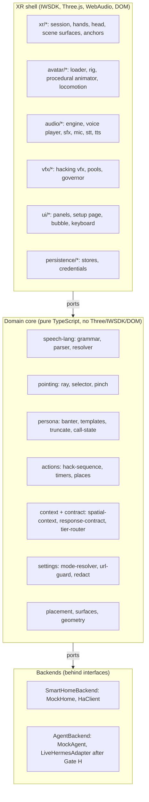
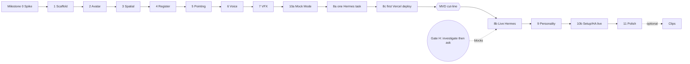
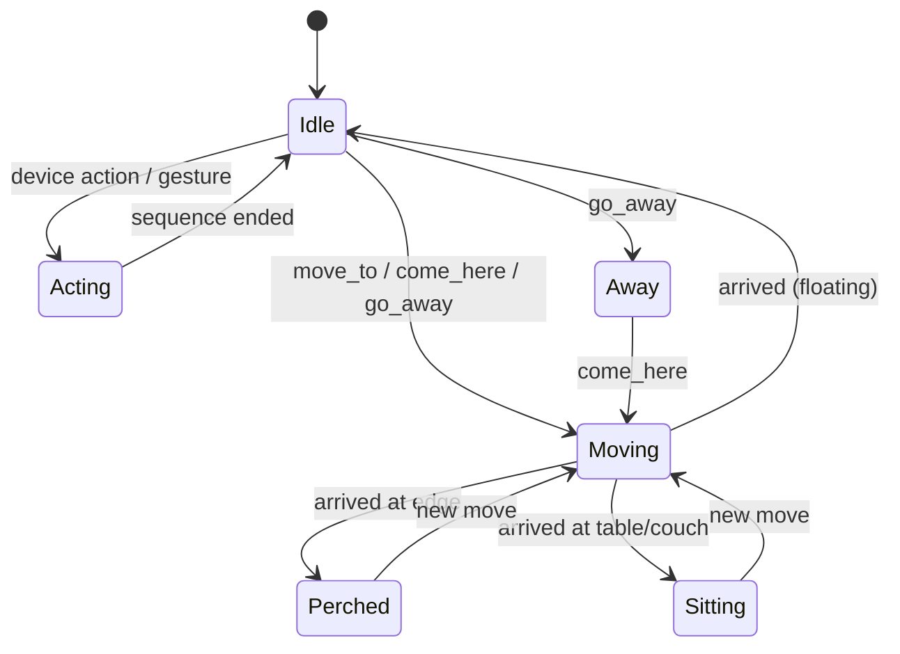
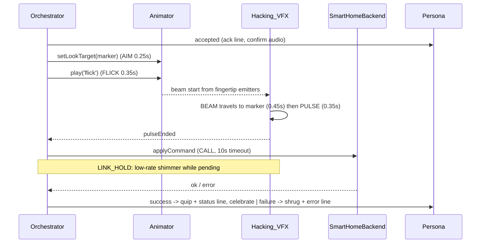

# Design Document

## Overview

Capri is a static WebXR app (TypeScript, Vite, IWSDK, Three.js, `@pixiv/three-vrm`) for Meta Quest 3 and 3S. A VRM avatar lives in the user's room in passthrough, reacts to hands and gaze, understands what the user points at, and acts on real lights through Home Assistant or delegates tasks to Hermes. The product is the Avatar, her spatial awareness, and her Persona. Home Assistant and Hermes are plug-in backends behind interfaces.

### Design goals

1. A demoable vertical slice by the MVD cut-line (Steps 1 to 7, Mock Mode, one Hermes task), with everything else removable.
2. Pure, testable core. All decision logic (parsing, grammar, selection, persona, sequencing, validation, redaction) is plain TypeScript with no Three.js, IWSDK, or DOM imports. It runs under Vitest and fast-check in Node.
3. Thin XR shell. IWSDK, Three.js, three-vrm, WebAudio, and Vosk are wrapped in adapters that implement small ports defined by the core.
4. Procedural animation first. Retargeted clips are an optional module behind the same `Animator` port. Nothing core imports it.
5. Zero-config Mock Mode is the default. Live Mode swaps backends behind identical interfaces.
6. 72 fps by construction: fixed particle budgets, cheap materials, no post-processing, no per-frame allocation in hot paths, measured on device.
7. No invented external APIs. Home Assistant uses only its documented REST API. Hermes is behind an adapter whose transport and wire format are unknown until the investigate-then-ask gate.

### Key decisions

| Decision | Choice | Reason |
|---|---|---|
| Framework | IWSDK (ECS over Three.js), one `CapriSystem` as the frame entry point | IWSDK provides session handling, scene understanding components, UIKit panels, and the IWER emulator. Our logic stays in plain classes so it is not tied to ECS. |
| Hosting | Static site on Vercel (Git integration or CLI) served from the user's own custom subdomain. Vite `base` = `/`. Security headers in `vercel.json`. | Requirement 30. No backend or bridge. A dedicated custom-subdomain origin isolates `localStorage` (credentials, saved light positions) to this app, so no other site shares the origin. The app is served from the root, so no repo-name base path is needed. Vercel issues HTTPS automatically, which WebXR requires. |
| Home Assistant | REST (`POST /api/services/light/<service>`, `GET /api/states`) from the browser. WebSocket optional later. | REST is stateless and enough for MVD. The WebSocket handshake (`auth_required`, `auth`, `auth_ok`) is documented if state push is added. |
| Hermes | `AgentBackend` interface. `MockAgentBackend` ships first. `LiveHermesAdapter` is written only after the investigate-then-ask gate. | Requirement 19. Transport (SSE, WebSocket, polling) is TBD. |
| STT | `vosk-browser@0.0.8`, small English model, restricted dynamic grammar with the `fragments` strategy. Grammar changes recreate the recognizer (median 4 ms, max 157 ms on the Quest). The model and the microphone permission are both prepared on the 2D Entry_Page before Enter AR. | Requirement 15. The published typings expose `new model.KaldiRecognizer(sampleRate, grammar?: string)`. No `setGrammar` exists in the browser API. The spike showed a 26 s cold model load with a 75 ms frame gap, and that the first microphone prompt inside AR ended the session. |
| Speech out | Pre-generated voice library (tier 1) for canned lines, speech bubble plus chirp (tier 3) for dynamic text such as Hermes replies. `speechSynthesis` (tier 2) stays in the code as a flag-guarded no-op that is off on Quest Browser. | Requirement 16. The spike found `speechSynthesis` missing on Quest Browser (`ttsUsable = false`). |
| Free-form chat | Via Hand_Keyboard text to Tier 2 | Vosk with a restricted grammar cannot transcribe arbitrary speech (Requirement 15.1 forbids other STT). This is an inherent limit, not a bug. |
| Avatar locomotion | Glide or float with bob and lean. Procedural sit and perch poses. | Requirement 11.1 allows "walk or float". No walk-cycle clips are needed. |
| Avatar scale | Normalised to a desk-companion height (default 0.6 m, tunable constant) from measured VRM height | Keeps swap-by-one-path (Requirement 10.3) working with any model, and makes sitting on a table plausible. |

## Verified API Baseline and Assumption Register

Verified against current documentation or published package contents on the design date. Anything not confirmed is an assumption with a validation point and a fallback.

### Verified

| Area | Verified fact | Source |
|---|---|---|
| IWSDK scaffold | `npm create @iwsdk@latest`. Project manifest `iwsdk.config.json`. Entry `World.create(container, projectOptions)`. Node 20.19+, 22.12+, or 24+. | Meta IWSDK Project Setup guide |
| IWSDK XR options | `xr: { sessionMode: SessionMode.ImmersiveAR, offer: 'none'\|'once'\|'always', features: { handTracking, anchors, hitTest, planeDetection, meshDetection, depthSensing, gazeTracking } }`. `world.launchXR()` starts a session. `launchXR` merges `world.xrDefaults`. | `packages/core/src/init/xr.ts`, `world-initializer.ts` |
| IWSDK features | `features: { sceneUnderstanding, environmentRaycast, spatialUI, physics, locomotion, grabbing }`. `physics: false` removes Havok from the bundle. | `world-initializer.ts`, Build and Deploy guide |
| Scene understanding | Components `XRPlane` (raw plane in `_plane`), `XRMesh` (`semanticLabel`, `isBounded3D`, `min`, `max`, `dimensions`), `XRAnchor`. Query `subscribe('qualify'\|'disqualify')`. | Scene Understanding guide |
| Persistent anchors | IWSDK stores a handle in the browser profile and tries to restore it on the same device when the runtime supports `requestPersistentHandle()` and `restorePersistentAnchor()`. | Scene Understanding guide |
| Environment raycast | `EnvironmentRaycastTarget` with `RaycastSpace.Left/Right/Viewer/Screen`. Needs `hitTest` and `features.environmentRaycast`. | Environment Raycast guide |
| Input spaces | `world.input.xr.xrOrigin` exposes `head`, `raySpaces`, `gripSpaces`. `MultiPointer` per hand. Hand visuals are `AnimatedHand`, updated via `XRFrame.fillPoses`. The multipointer is enabled only when the primary source has a gamepad. On Quest, hand input sources do expose a `gamepad` with target-ray mode `tracked-pointer` (spike item (a)), but our code never relies on it. | XR Input and XR Origin docs, spike item (a) |
| Spatial UI | UIKitML (`.uikitml` under `public/ui`), `features.spatialUI`, elements and click listeners via `requireElementById`. UIKit units are centimetres at scale 1. | Spatial UI guide |
| Emulator | IWER injected by `iwsdkDev()`. Device presets (`metaQuest3` etc.). `dev.emulator.environment` rooms report planes, meshes, and a global mesh. Input mode switch between controllers and hands. IWER does not emulate WebXR Layers. | Testing Experience guide |
| three | `@iwsdk/core@1.1.0` depends on `three: npm:super-three@0.185.0`. `@pixiv/three-vrm@3.5.5` peer is `three >=0.137`. | npm registry |
| three-vrm | `VRMLoaderPlugin`, `VRMUtils.removeUnnecessaryVertices/removeUnnecessaryJoints/combineSkeletons/combineMorphs/rotateVRM0/deepDispose`, `vrm.humanoid.getNormalizedBoneNode(name)`, `vrm.expressionManager.setValue(name, v)` with presets `aa ih ou ee oh blink blinkLeft blinkRight happy angry sad relaxed surprised neutral lookUp lookDown lookLeft lookRight`, `vrm.lookAt.target = Object3D`, `vrm.update(dt)` after bone writes, `VRMLookAtQuaternionProxy` and `@pixiv/three-vrm-animation` for clips. | three-vrm examples and source (via Context7) |
| vosk-browser | Published `0.0.8` typings: `createModel(url, logLevel?)`, `Model.KaldiRecognizer(sampleRate: number, grammar?: string)`, `acceptWaveform(AudioBuffer)`, `acceptWaveformFloat(Float32Array, sampleRate)`, `retrieveFinalResult()`, `setWords`, `remove()`, `on('result'\|'partialresult')`, `model.terminate()`. The package README still shows a no-argument constructor and is stale. Library runs in a Web Worker. | `vosk-browser@0.0.8` `model.d.ts` and `lib/src/model.ts` |
| Semantic labels | Quest Browser returned `ceiling, couch, door, floor, shelf, table, wall art, wall` in the spike (no `desk` seen). Registry vocabulary: `desk, couch, floor, ceiling, wall, door, window, table, shelf, bed, screen, lamp, plant, wall art, global mesh, other`. Both `desk` and `table` exist. | `immersive-web/semantic-labels` `labels.json` |
| Home Assistant REST | `Authorization: Bearer <token>`. `GET /api/states`. `POST /api/services/<domain>/<service>` waits for completion and returns the list of changed states. 401 unauthorized, 404 not found, 500 on action error. | HA REST API documentation |
| Home Assistant light fields | `light.turn_on` accepts `brightness_pct`, `rgb_color`, `color_name`. | HA light action documentation |
| Home Assistant CORS | From Home Assistant 2026.8 the HTTP integration is configured in the UI (Settings, System, Network, HTTP server, "CORS allowed origins"). An existing YAML `http:` block is imported and then flagged as deprecated. The README must document both the UI path and the `cors_allowed_origins` YAML snippet for older versions. | HA HTTP integration documentation |
| Vercel hosting | `vercel.json` supports `buildCommand`, `installCommand`, `outputDirectory`, `rewrites`, and `headers`. A custom subdomain is attached in the project's Domains settings and configured with a project-specific `CNAME` record that the dashboard displays. Vercel provisions the HTTPS certificate. A failed build does not replace the current production deployment. | Vercel documentation (project configuration, add a domain) |

### Assumption register

Each assumption is validated at the stated point. On failure, the developer tells the user immediately and applies the fallback (Requirements 1.5 to 1.8, 29.8).

| ID | Assumption | Validate at | Fallback |
|---|---|---|---|
| A1 | IWSDK 1.1.x behaves as the docs (written against 0.5.3) describe: `World.create` options, `offer: 'none'`, `world.launchXR()`, `SceneUnderstandingSystem` auto-registered by `features.sceneUnderstanding`. | M0 pre-flight and item (a) | Pin the exact scaffolded version. Read its typings. Adjust `app/capri-system.ts` only. |
| A2 | One copy of `three` is bundled (IWSDK's `super-three` alias satisfies `three-vrm`). `three/addons` or `three/examples/jsm` loader import paths resolve. | M0 pre-flight (`npm ls three`, `vite build`) | Add `resolve.dedupe: ['three']` and alias. |
| A3 | Hand joints are readable via raw WebXR (`inputSource.hand`, `frame.getJointPose`, `frame.fillPoses`) using `renderer.xr.getFrame()` and `renderer.xr.getSession().inputSources`. IWSDK has no documented joint API. **Confirmed on Quest (spike):** 25 of 25 joints per hand, and `xrOrigin.indexTipSpaces` matches the `index-finger-tip` joint (0.0 mm over 670 frames), so the pointing ray origin may use `indexTipSpaces`. | M0 item (a) | Use IWSDK `xrOrigin` ray/grip spaces plus wrist pose for a coarse ray (not needed). |
| A4 | `XRPlane.semanticLabel` and `XRMesh.semanticLabel` are populated by the Quest Browser (read through the IWSDK component's raw `_plane` / `_mesh`). | M0 item (b) | Manual surface tagging: user pinches a surface and picks floor/table/couch from a hand-operated list. |
| A5 | Persistent anchors survive page reload on Quest 3/3S. **Confirmed with a measured error:** the restored anchor was 95 mm from where it was saved (one measurement). In-session drift was 2 to 3 mm. See the tolerance statement under Device registration and persistence. | M0 item (b) restart check | `localStorage` positions plus a visible "Re-teach lights" action. Try `bounded-floor` reference space for session-to-session stability. |
| A6 | Quest hand input sources DO expose a `gamepad` with target-ray mode `tracked-pointer` (spike item (a)). Whether the IWSDK multipointer activates for hands was not tested. Our selection does not depend on the gamepad or the multipointer. Panel interaction (poke and ray pinch) must work. | Step 1 headset check (task 3.5): a hand-operated test panel | Own poke and pinch detection on UIKit hit volumes via `domain/pointing/pinch.ts`. |
| A7 | `getUserMedia` works during an immersive session once permission is already granted. **Confirmed with a constraint (spike):** the first permission prompt inside the AR session ended the session. The product therefore requests permission on the 2D Entry_Page and never inside the session. The spike recognizer ran at the 48 kHz context rate. A 16 kHz `AudioContext` was not tried, so the stream is resampled or the recognizer is created at the context rate. | M0 item (c), Step 6 | Mic permission on the Entry_Page before Enter AR (now the primary path). Use separate capture and output contexts. If permission is denied: Quick_Actions and Hand_Keyboard only. |
| A8 | `vosk-browser@0.0.8` bundles under Vite (inline worker) and loads a model from the same origin. **Confirmed on Quest (spike):** 41 MB model, 26 s cold load, cached in IndexedDB. | M0 item (d) | Self-host the UMD `vosk.js` in `public/vosk/` and load it with a script tag. |
| A9 | The small English model accepts a dynamic grammar (needs `graph/Gr.fst` and `graph/HCLr.fst`). Out-of-vocabulary grammar words are dropped with a warning. | M0 item (d) | Build-time lexicon filter (`words.txt`). Fewer, shorter phrases. |
| A10 | A grammar made of fragments (verb, deictic, name entries) lets Vosk output a sequence such as "turn off that". **Confirmed (spike, 3 of 3): `grammarStrategy = 'fragments'`.** The recognizer can still return a multi-word hypothesis for a short command (spike: "come here" heard as "turn on turn off"), which the confidence handling covers. If composition fails, enumerate full utterances (`strategy: 'utterances'`). | M0 item (d) composition probe | `GrammarStrategy` switch in `grammar-builder.ts`. Parser is unchanged. |
| A11 | Recreating a recognizer (`remove()` then `new KaldiRecognizer(...)`) takes well under 1 s with the model already loaded. **Confirmed (spike): median 4 ms, max 157 ms.** | M0 item (d) | Debounce shorter. Pre-build the next recognizer, then swap. |
| A12 | `speechSynthesis` may be absent or poor on Quest Browser. **Confirmed absent (spike): `window.speechSynthesis` and `SpeechSynthesisUtterance` are missing, `ttsUsable = false`.** | M0 item (e) | Tier 3 (bubble and chirp) for dynamic text, tier 1 library for canned lines. No synthetic mouth flap. |
| A13 | MP3 decodes in Quest Browser via `decodeAudioData`. Opus-in-Ogg is a size alternative. | Step 6 first run | Switch format in `tools/voice-script`. |
| A14 | IWER hand emulation cannot pose individual fingers, so pointing is not drivable by IWER's hand model. | M0 pre-flight, Step 5 | Dev-only `FakeHands` joint provider (`?fakehands`) feeds scripted joint poses to the same pointing code. |
| A15 | Eye tracking is not available on Quest 3 or 3S. Gaze means head forward direction. | Step 5 | `GazeProvider` port. An eye-gaze implementation can be added later without core changes. |
| A16 | MToon material and spring bones fit the 13.9 ms budget with outlines off. | Step 2 measurement | Lever order in the Performance section. |
| A17 | `light.turn_on` `rgb_color` is valid only for color-capable lights. Capability is read from the entity attribute `supported_color_modes`. | Step 4 against the user's Home Assistant | Persona says that light cannot do colours. |
| A18 | The official `vosk-model-small-en-us-0.15` archive needs repackaging into the layout vosk-browser expects (including `conf/model.conf`). | M0 item (d) | Use a pre-packaged tarball from the vosk-browser demo, copied into our own assets (model license is Apache-2.0). |
| A19 | The CSP in `vercel.json` (`script-src 'self' 'wasm-unsafe-eval'`, `worker-src 'self' blob:`, `connect-src 'self' https: wss: blob:`) is enough for IWSDK, three-vrm, and vosk-browser (inline blob worker plus WASM compile) to run on the deployed site. | First hosted deploy (task 19.6), checked on the Quest Browser and in desktop Chrome DevTools | Ship the policy as `Content-Security-Policy-Report-Only` first if a violation is found, then relax only the single offending directive (for example add `'unsafe-eval'` to `script-src` if the worker needs it) and record why. |
| A20 | Vercel verifies the user's custom subdomain through a `CNAME` record at the user's DNS provider and then issues HTTPS automatically. | Task 19.6, after the user adds the record | Use the project's default `*.vercel.app` URL for testing and tell the user which record is missing. Do not hard-code any origin. |

## Architecture

### Layers



Rules:

- `domain/` imports nothing from `three`, `@iwsdk/*`, `vosk-browser`, `window`, or `document`. A lint rule and a test (`tests/unit/arch.test.ts`) enforce it. Time comes from an injected `Clock`, randomness from an injected `Rng`.
- Shell adapters implement ports declared in `domain/`. Core never reaches into the shell.
- Backends implement `SmartHomeBackend` and `AgentBackend`. `Persona`, `ActionOrchestrator`, and `Procedural_Animator` are identical in Mock and Live (Requirement 23.8).
- Two-way coupling uses a typed synchronous `AppEvents` bus (`registry:changed`, `pointed:changed`, `selected:changed`, `intent:resolved`, `call:state`, `connection:changed`, `speech:start`, `speech:end`, `session:paused`).

### Frame loop and IWSDK integration

One IWSDK system is the entry point. It owns no domain logic.

```ts
// src/app/capri-system.ts
export class CapriSystem extends createSystem({
  planes: { required: [XRPlane] },
  meshes: { required: [XRMesh] },
}) {
  private app!: CapriApp;
  init() {
    this.app = this.globals.capri as CapriApp;           // built in main.ts
    this.queries.planes.subscribe('qualify', e => this.app.surfaces.addPlane(toSurfaceInput(e)));
    this.queries.planes.subscribe('disqualify', e => this.app.surfaces.remove(e.index));
    this.queries.meshes.subscribe('qualify', e => this.app.surfaces.addMesh(toSurfaceInput(e)));
    this.queries.meshes.subscribe('disqualify', e => this.app.surfaces.remove(e.index));
  }
  update(dt: number, time: number) { this.app.tick(dt, time); }
}
```

`app.tick` runs in this fixed order, each step wrapped by `safeRun` (error isolation, see Error Handling):

1. `xr.readFrame(frameCtx)` fills a reused `FrameContext` (head pose, per-hand joint poses, pinch states). No allocation.
2. `pointing.update(frameCtx)` produces `Pointed_Device` and `selected`.
3. `voice.update()` handles push-to-talk edge detection.
4. `orchestrator.update(dt)` advances the active `HackSequence`, timers, and Tier 2 task events.
5. `idle.update(dt)` handles idle behaviour scheduling and follow rules.
6. `animator.update(dt, frameCtx)` writes normalised bones and expressions, then `vrm.update(dt)`.
7. `vfx.update(dt)` and `ui.update(dt)`.
8. `perfOverlay.sample(dt)` (dev only).

### World configuration

```ts
// src/main.ts (excerpt)
const world = await World.create(container, {
  ...projectOptions,                         // from iwsdk.config.json (scene, assets, manifest)
  xr: {
    sessionMode: SessionMode.ImmersiveAR,
    offer: 'none',                           // our Setup_Page owns "Enter AR"
    referenceSpace: { type: ReferenceSpaceType.LocalFloor, fallbackOrder: [ReferenceSpaceType.Local, ReferenceSpaceType.Viewer] },
    features: {
      handTracking: { required: true },
      anchors: true, hitTest: true, planeDetection: true, meshDetection: true,
      // depthSensing is requested only when featureFlags.depthOcclusion is true (bonus, see Performance plan).
    },
  },
  features: { spatialUI: true, sceneUnderstanding: true, environmentRaycast: true,
              physics: false, locomotion: false, grabbing: false },
});
world.registerSystem(CapriSystem);
enterButton.onclick = async () => { await audio.unlock(); world.launchXR(); };   // never calls getUserMedia, see Mic_Setup_Step
```

`iwsdk.config.json` holds the serializable parts. Executable behaviour stays in code, per IWSDK guidance. `handTracking` is required because the product is hands-only (Requirement 8.1). If the session request fails, the Setup_Page shows the failure reason and keeps the page usable.

### Time, randomness, and units

- `Clock { now(): number }` returns monotonic milliseconds. Production uses `performance.now()`. Tests use a fake clock.
- `Rng { next(): number }` returns values in [0, 1). Production uses a seeded PRNG so VFX and idle scheduling are reproducible in tests.
- World units are metres. UIKit panels use centimetres at scale 1, so each panel entity carries a documented scale of 0.01 (verified in IWSDK docs).

## Module Structure

```text
capri/
├─ index.html                  Setup_Page (2D DOM) + #scene-container        [MVD]
├─ spike.html                  Milestone 0 harness entry (separate Vite input)   [M0]
├─ iwsdk.config.json           world/xr/features/dev.emulator settings           [MVD]
├─ vite.config.ts              iwsdkDev(), base = "/", two inputs                [MVD]
├─ vercel.json                 static Vite build, dist, SPA-safe rewrites, security headers   [MVD]
├─ .env.example                dev-only placeholders                              [MVD]
├─ voice/voice-manifest.txt    Voice_Manifest                                     [MVD]
├─ public/
│  ├─ models/capri.vrm         placeholder VRM (path named only in avatar-config)
│  ├─ voice/*.mp3              generated Voice_Library
│  ├─ vosk/                    model tarball (fetched by script, git-ignored)
│  └─ ui/*.uikitml, scenes/main.iwsdk.scene.json
├─ tools/                      dev-time only, never bundled
│  ├─ voice-script/            generate-voice-library.ts, engines/*
│  ├─ fetch-vosk-model.ts, build-lexicon.ts
│  └─ checks/                  smoke checks (secrets leak, assets https, manifest, docs)
├─ docs/                       spike-report.md, hermes-integration.md, performance-note.md,
│                              comfort-check.md, demo-path.md, hosting.md, THIRD_PARTY.md
├─ src/
│  ├─ main.ts                  composition root
│  ├─ app/                     capri-system, app, events, clock, rng, frame-context, safe-run
│  ├─ config/                  avatar-config.ts (the single VRM path), constants.ts
│  ├─ domain/                  PURE
│  │  ├─ geometry.ts           vec ops, ray-sphere, angle clamp
│  │  ├─ surfaces.ts           SurfaceLabel mapping, navigation targets
│  │  ├─ placement.ts          idle constraint, visibility policy, floor-or-float
│  │  ├─ ui-placement.ts       panel zones
│  │  ├─ devices/              registry.ts, naming.ts
│  │  ├─ pointing/             ray.ts, selector.ts, pinch.ts
│  │  ├─ speech-lang/          phrases.ts, grammar-builder.ts, intent-parser.ts, resolver.ts, lexicon.ts
│  │  ├─ persona/              persona.ts, banter.ts, templates.ts, truncate.ts, action-memory.ts, call-state.ts
│  │  ├─ actions/              hack-sequence.ts, timers.ts, places.ts, abilities.ts
│  │  ├─ context/              spatial-context.ts
│  │  ├─ contract/             response-contract.ts, tier-router.ts, task-model.ts
│  │  ├─ speech/               tier-select.ts, variant-picker.ts, lip-flap.ts, voice-manifest.ts
│  │  └─ settings/             mode-resolver.ts, url-guard.ts, redact.ts, credentials.ts, status.ts
│  ├─ backends/
│  │  ├─ types.ts              SmartHomeBackend, AgentBackend, BackendError
│  │  ├─ mock/                 mock-home.ts, mock-agent.ts
│  │  ├─ ha/                   ha-requests.ts (pure), ha-client.ts, ha-errors.ts
│  │  └─ hermes/               hermes-adapter.ts (interface), live-hermes-adapter.ts*, transports/*  (*after Gate H)
│  ├─ xr/                      session.ts, hands.ts, head.ts, scene-surfaces.ts, anchors.ts, hit-capture.ts, fake-hands.ts (dev)
│  ├─ avatar/                  avatar-loader.ts, avatar-rig.ts, procedural-animator.ts, pose-buffer.ts,
│  │                           gestures/*.ts, locomotion.ts, mouth.ts, gesture-router.ts, clips/* [OPTIONAL]
│  ├─ audio/                   audio-engine.ts, voice-player.ts, sfx-synth.ts, tts-fallback.ts, mic-capture.ts, stt-engine.ts
│  ├─ vfx/                     hacking-vfx.ts, particle-pool.ts, beam.ts, glyphs.ts, pulse.ts, quality-governor.ts
│  ├─ ui/                      panels/*, setup-page/*, speech-bubble.ts, hand-keyboard.ts, status-chips.ts,
│  │                           loading.ts, pause.ts, perf-overlay.ts, device-marker.ts
│  ├─ persistence/             device-store.ts, local-store.ts, anchor-store.ts, credential-store.ts, places-store.ts
│  └─ spike/                   spike-main.ts, items/{a..e}.ts, report.ts, workarounds.ts
└─ tests/                      unit/, property/, component/, arbitraries/, fixtures/
```

### Cut-line (MVD) mapping to modules

The table fixes the order and the cut-line, not durations. Deadline for context: Nov 18, 2026, 12:00pm PST (Requirement 7.9).

| Tier | Step | Modules delivered | Requirements |
|---|---|---|---|
| M0 | Spike | `spike/*` (reuses `audio/mic-capture`, `audio/stt-engine`, `xr/hands`, `xr/scene-surfaces` drafts), `docs/spike-report.md` | 1 to 6 |
| MVD | 1 Scaffold and passthrough | `main.ts`, `app/*`, `xr/session`, `xr/hands`, `ui/status-chips` (stub), hand-lost message | 8, 9, 29, 30 |
| MVD | 2 Avatar presence | `avatar/avatar-loader`, `avatar-rig`, `procedural-animator`, `pose-buffer`, `gestures/{idle,blink,breathe,wave,lookat}`, `config/avatar-config`, `domain/placement` | 10 |
| MVD | 3 Spatial interaction | `xr/scene-surfaces`, `domain/surfaces`, `avatar/locomotion`, `gestures/{point,sit,perch}`, `domain/actions/abilities` | 11 |
| MVD | 4 Device registration | `domain/devices/*`, `persistence/{device-store,local-store,anchor-store}`, `xr/hit-capture`, `ui/device-marker`, `ui/panels/device-list`, "Teach me your lights" flow | 12 |
| MVD | 5 Pointing | `domain/pointing/*`, `xr/hands`, `xr/head`, marker highlight, gaze link to animator | 13 |
| MVD | 6 Voice loop | `audio/{mic-capture,stt-engine,audio-engine,voice-player}`, `domain/speech-lang/*`, `domain/speech/*`, `domain/persona/*`, `ui/panels/{mic-orb,transcript,quick-actions}`, `ui/hand-keyboard`, `tools/voice-script`, `voice/voice-manifest.txt` | 14, 15, 16, 17, 22 |
| MVD | 7 Hacking VFX | `vfx/*`, `domain/actions/hack-sequence`, `audio/sfx-synth`, `avatar/gestures/{flick,shrug,celebrate}` | 18 |
| MVD | 10a Mock Mode | `backends/types`, `backends/mock/*`, `domain/settings/mode-resolver`, `ui/status-chips` (full), `ui/setup-page` (mock default) | 23, 27 |
| MVD | 8a One Hermes task | `backends/hermes/hermes-adapter` interface, `MockAgentBackend` scripted task, `ui/panels/task-panel`, `domain/contract/task-model`. Live adapter only after Gate H (investigate, then ask). | 19, 23.5 |
| MVD | 8c First Vercel deploy | `vercel.json` (static Vite build, `dist`, SPA-safe rewrites, security headers), `build:vercel` script (test, Vosk model fetch, build), Vercel project deployed through Git integration or CLI, user's custom subdomain attached, hosted Mock Mode link handed off for the headset | 8.9, 30.2 to 30.4, 30.9 to 30.14 |
| Post-MVD | 8b Live Hermes and Tier 2 | `backends/hermes/live-hermes-adapter`, `transports/*`, `domain/contract/*`, `domain/context/spatial-context`, `docs/hermes-integration.md` | 19, 20, 26.4 |
| Post-MVD | 9 Personality | `gestures/{stretch,fidget,glance,ignored,notify,tease}`, idle scheduler, banter memory | 21, 17.8 to 17.10 |
| Post-MVD | 10b Setup, HA live, CORS docs | `ui/setup-page` (full), `persistence/credential-store`, `backends/ha/*`, README sections | 24, 25, 26, 27 |
| Post-MVD | 11 Polish | `ui/{loading,pause,perf-overlay}`, audio mix, comfort check, `docs/{performance-note,comfort-check,demo-path}.md`, `npm run check` added to the `build:vercel` script | 28, 29, 30, 31 |
| OPTIONAL | Clips | `avatar/clips/*`, `gesture-router` clip branch | 32 |

Schedule risk: the spec was written on Nov 16, 2026 and the deadline is Nov 18, 2026, 12:00pm PST, so the MVD takes most of the available working time and every on-headset check depends on the user being available. The design therefore relies on ordering and cut-lines instead of duration estimates. The MVD is the smallest slice that still satisfies the competition constraints, Post-MVD items are independently removable, and the hand-off notes after each step never block the next step (except the Milestone 0 failure gate and Gate H). The hosted link on the custom subdomain is a mandatory deliverable (Requirements 8.9, 31.1), which is why the first deploy sits inside the MVD (step 8c) and not in polish. It also carries the user-dependent work (custom subdomain, DNS `CNAME`, domain verification in Vercel), so it starts as soon as the MVD modules exist and the user's input can arrive while later work continues.

Cut order under schedule pressure (Requirement 7.5): OPTIONAL clips, then Post-MVD remainder (11 polish items one by one, 9, 10b live HA, 8b live Hermes), never an MVD module. If Live HA is cut, the submission still satisfies Requirement 8.8 through Mock Mode.

Hermes inside the MVD: the "one Hermes task" slice is the `AgentBackend` interface, the `Task_Panel`, and the scripted task in Mock Mode (also the judges' stand-in per Requirement 23.5). Gate H is the investigate-then-ask step: no `live-hermes-adapter` code exists before the developer has investigated the real surface and the user has supplied endpoint, authentication, and one working call. If the user supplies these in time, the live adapter replaces the mock for the demo video.



### Hand-off notes and waiting rules

After each step the developer writes a short, non-blocking hand-off note (Requirements 7.6 and 7.12) with three parts: what to test, what the user should see, and how to open the build on the Quest (the HTTPS dev URL, a LAN IP, `adb reverse`, or the hosted custom-subdomain URL once it exists). The developer then continues to the next task. No timestamps, durations, or timing reports are collected from the user (Requirement 7.13).

Only four things make the developer stop and wait:

| Wait point | Rule | Requirement |
|---|---|---|
| Milestone 0 item failure | State the failure plainly, give the cheapest workaround, wait for the user's confirmation | 1.5 to 1.8 |
| Gate H (Hermes) | Investigate the real integration surface first, then ask the user for endpoint, authentication, and one working call. No Hermes client code before that | 19.1, 19.2 |
| Failure on the device outside Milestone 0 | Tell the user at once and propose the cheapest workaround, then continue with unaffected work | 29.8 |
| A specific missing input | Ask one item at a time: voice engine (before Step 6), custom subdomain and Vercel domain verification (task 19.6), Home Assistant details (Step 10b), Hermes details (Gate H) | 29.10, 30.14 |

If a wait point is open but unrelated tasks can proceed, the developer proceeds with those and keeps the question visible.

## Milestone 0 Spike Harness

The spike is a separate Vite input (`spike.html`, `src/spike/spike-main.ts`). It starts an immersive AR session with the same `World.create` options as the product, then shows an in-scene list of five items. It follows a soft guideline of about 2 hours of working time (Requirement 1.2), with no timestamp logging, and is written so that validated probes become production modules.

### Pre-flight desk checks (no headset)

| Check | Command or action | Validates |
|---|---|---|
| Scaffold and versions | `npm create @iwsdk@latest`, record exact `@iwsdk/core` version | A1 |
| Single `three` | `npm ls three`, `vite build` with `@pixiv/three-vrm` imported | A2 |
| Root base path | `vite build` and `vite preview` serve the app from `/` and every asset URL resolves | Requirement 30.2 |
| Emulator rooms | `dev.emulator.environment` set to `home_office`, confirm planes appear in IWER | A14 background |
| Vosk bundling | import `vosk-browser`, build, load a tiny test in desktop Chrome | A8 |
| Vosk model packaging | run `tools/fetch-vosk-model.ts`, confirm tarball layout | A18 |

### Harness structure

```ts
interface SpikeItem {
  id: 'a' | 'b' | 'c' | 'd' | 'e';
  title: string;
  /** Exact steps the user performs on the headset, shown in-scene and in the final report (Req 1.9). */
  instructions: string[];
  run(ctx: SpikeContext): Promise<SpikeResult>;
}
type Verdict = 'works' | 'does_not_work';
interface SpikeResult {
  item: SpikeItem['id'];
  verdict: Verdict;
  capabilities?: Record<string, Verdict>;     // item (b): six separate capabilities (Req 3.8)
  measurements?: Record<string, number | string>;
  failureReason?: string;                     // plain words, no secrets
}
```

- `SpikeRunner` renders one UIKit row per item (status: pending, running, needs-user, works, fails) and a `Next` button operated by pinch.
- On failure the row shows the failure reason and the pre-written cheapest workaround from `spike/workarounds.ts`. The developer relays both to the user and waits for confirmation before continuing (Requirements 1.5 to 1.8). The harness spends no further time on a failed item.
- `buildReport(results)` is pure. It returns Markdown with exactly one verdict line per item and six separate capability lines under item (b). When the session ends, the 2D page shows the report text in a `<textarea>` with a Copy button so the user can paste it back. The developer saves it as `docs/spike-report.md`.

### Items

| Item | What runs | Measured and shown | Pass rule |
|---|---|---|---|
| (a) AR session, passthrough, hand joints | Start `immersive-ar` with `handTracking`. Draw 25 joint spheres per hand from `frame.getJointPose`. | Joints per hand per frame, input source list (`hand` present, `gamepad` reported as found, which on Quest is present with mode `tracked-pointer`), whether any controller is connected | Both hands report poses, no controller connected |
| (b) Scene understanding | Subscribe to `XRPlane` and `XRMesh`. Read `semanticLabel`. On dominant pinch run `EnvironmentRaycastTarget` hit-test, place an `XRAnchor` at the hit, check it holds for 300 frames. Place the stand-in avatar (capsule with head sphere using the production `placement.ts`) on the floor and at a table. Optional bonus: request `depthSensing` and show whether occlusion renders. Restart check: save the anchor handle if `requestPersistentHandle` exists, reload the page, try to restore. | Planes count and labels, mesh available, hit-test result, anchor persists across frames, persistent restore result, depth bonus | Six capability rows reported separately (planes, semantic labels, mesh, anchors, hit-test, depth occlusion) |
| (c) Mic in session | Pinch to call `getUserMedia({ audio: { echoCancellation: true, noiseSuppression: true, channelCount: 1 } })` during the session. `AnalyserNode` drives a bar in the scene. | Permission outcome, stream sample rate, capture active, live level, error name mapped to a plain reason | Level bar moves with speech |
| (d) Vosk | Load model from the same origin and time it with `performance.now()`. Create recognizer with the restricted grammar `["turn on","turn off","come here","[unk]"]`. Prompt each phrase 10 times. Composition probe: fragment grammar `["turn off","that","[unk]"]`, say "turn off that". Recreate probe: time `remove()` plus new recognizer. | Load time (s), per-phrase correct count out of 10, composition probe result, recreate latency (ms) | Loads, recognises, per-phrase accuracy reported |
| (e) speechSynthesis | `'speechSynthesis' in window`, wait for `voiceschanged`, list voices, speak one sentence per English voice, show Usable / Not usable buttons. | Existence, voice list, user ratings | Verdict states whether any voice is usable |

Item (d) feeds decisions A8 to A11 and A18. Item (b) feeds A4 and A5. Item (c) feeds A7. Item (e) feeds A12.

### Spike outcome (Quest 3, Quest Browser 156)

Items (a) to (d) work. Item (e) fails and the tier 3 workaround is applied. The user approved continuing with the workarounds. The consequences carried into this design are: tier 2 speech disabled, microphone permission and the Vosk model prepared on the 2D page, the `fragments` grammar strategy, an explicit anchor restore tolerance, the Quest label set and the table selection rule, the hand `gamepad` note, the `indexTipSpaces` ray origin, and depth occlusion as a flagged bonus. Details are in `docs/spike-report.md`.

### Failure workarounds (cheapest first)

| Failed item | Workaround proposed to the user |
|---|---|
| (a) hand joints | Use IWSDK ray/grip spaces for a coarse pointing ray. Pinch and poke come from `select` events. |
| (b) semantic labels | Manual surface tagging by pinch plus a hand-operated label list. |
| (b) mesh detection | Planes only. `sit_on` and `perch` use planes. |
| (b) anchors or persistence | `localStorage` positions plus "Re-teach lights". |
| (b) hit-test | Intersect the pointing ray with plane quads. Fall back to a fixed distance along the ray with nearer/farther buttons. |
| (c) mic in session | Request permission on the Setup_Page (Mic_Setup_Step) before Enter AR. Otherwise Quick_Actions and Hand_Keyboard only. This workaround is now required, because the first prompt inside the AR session ended the session on the Quest. |
| (d) Vosk load or accuracy | Quick_Actions and Hand_Keyboard become primary. Shrink the grammar. |
| (e) speechSynthesis | Tier 3 (bubble and chirp) for dynamic text. Applied: `speechSynthesis` is missing on Quest Browser. |

## Components and Interfaces

### Shared core types

```ts
type Vec3 = { x: number; y: number; z: number };
type Quat = { x: number; y: number; z: number; w: number };
type Pose = { position: Vec3; rotation: Quat };

type SurfaceLabel = 'floor' | 'ceiling' | 'wall' | 'table' | 'desk' | 'couch' | 'other';   // door, shelf, wall art, and every other raw label map to 'other'
interface Surface {
  id: string;
  label: SurfaceLabel;
  rawLabel: string;                 // as reported, kept for diagnostics
  center: Vec3;
  normal: Vec3;
  /** Convex footprint in surface-local XZ, metres. Planes are rectangles; meshes use their box. */
  halfExtents: { x: number; z: number };
  topY?: number;                    // horizontal surfaces
}

interface DeviceRecord {
  id: string;                       // uuid
  entityId: string;                 // Home Assistant light.* entity or mock id
  name: string;                     // spoken name
  aliases: string[];                // e.g. head noun "lamp"
  position: Vec3;                   // last known, session reference space
  anchorHandle?: string;            // persistent anchor handle when supported
}

type DeviceCommand =
  | { kind: 'on' } | { kind: 'off' }
  | { kind: 'brightness'; pct: number }               // 0..100
  | { kind: 'color'; rgb: [number, number, number]; name: string };

type Emotion = 'neutral' | 'happy' | 'smug' | 'surprised' | 'annoyed' | 'sad' | 'relaxed';
type GestureId = 'wave' | 'flick' | 'point' | 'shrug' | 'celebrate' | 'tease' | 'stretch' | 'fidget'
               | 'glance' | 'ignored' | 'notify' | 'sit' | 'perch' | 'none';
```

### Avatar and Procedural_Animator

**Loader** (`avatar/avatar-loader.ts`): `GLTFLoader` with `VRMLoaderPlugin`. After load: `VRMUtils.removeUnnecessaryVertices`, `removeUnnecessaryJoints`, `combineSkeletons`, `combineMorphs`, `rotateVRM0(vrm)` for VRM 0.x, `frustumCulled = false` on all meshes. The URL comes only from `config/avatar-config.ts` (`export const AVATAR_VRM_URL = assetUrl('models/capri.vrm')`), which is the single path (Requirement 10.3). It measures `AvatarMetrics { height, hipHeight, armLength, eyeHeight }` from humanoid bones and applies a uniform scale so `height = AVATAR_TARGET_HEIGHT_M` (0.6). A load failure returns `Err(AvatarLoadError)`. The app shows a bubble naming the failure and keeps the session running with a marker-less empty avatar slot (Requirement 10.13).

**Animator port** (the only thing core and orchestrator see):

```ts
interface Animator {
  play(g: GestureId, opts?: { target?: Vec3 }): Promise<void>;   // resolves when finished
  setLookTarget(t: Vec3 | 'user' | null): void;
  setPointTarget(t: Vec3 | null): void;
  setEmotion(e: Emotion): void;
  setMouth(open01: number): void;                                // from lip-flap, tier 1 voice library audio only
  update(dt: number, f: FrameContext): void;
}
```

**ProceduralAnimator** composes layers. Each layer writes weighted rotations into a reused `PoseBuffer` (a quaternion per humanoid bone with weight). One pass applies the buffer to `vrm.humanoid.getNormalizedBoneNode(...)`, then `vrm.update(dt)` runs, which syncs raw bones, applies `lookAt`, expressions, and spring bones.

| Layer | Behaviour | Requirement |
|---|---|---|
| Rest pose | Lowers arms from the T-pose to a relaxed pose (`upperArm.z` about ±1.2 rad). Sets seated or standing leg pose. | 10 |
| Breathing | Chest and spine sine, amplitude about 0.01 rad, period about 4 s. Always bounded. | 10.7 |
| Blink | `expressionManager.setValue('blink', …)` with a 120 ms close and open curve. Next interval drawn uniformly from [2 s, 6 s] with the injected `Rng`. | 10.8 |
| Look | Head and neck rotate toward the look target. Eyes via `vrm.lookAt.target`. Direction is converted to the torso frame, yaw clamped to ±70°, pitch to ±40° (`clampLook`, pure), split 60% head and 40% neck, smoothed with critically damped springs. | 10.9, 10.12 |
| Gesture | Keyframed procedural tracks (see below) blended in and out. | 10.10, 11, 18, 21 |
| Speech mouth | Sets `aa` from `setMouth()`. Driven only by tier 1 library audio amplitude, never by a synthetic oscillator. | 16.11, 16.13 |
| Emotion | Sets `happy`, `relaxed`, `surprised`, `angry`, `sad` weights with smoothing. Unknown names map to `neutral`. | 20.5 |
| Locomotion bob | Vertical bob and forward lean while gliding. | 11.1 |

Gestures are data, not code:

```ts
interface GestureDef {
  id: GestureId;
  duration: number;                    // seconds
  tracks: Array<{ bone: HumanoidBoneName; euler: 'x'|'y'|'z'; keys: Array<[t: number, rad: number]>; ease?: 'sine'|'back'|'linear' }>;
  aimsAtTarget?: boolean;              // point and flick use the aim solver
}
```

`flick` is a 0.35 s snap: upper arm raise, forearm flick, finger spread. `point` uses a pure aim solver `aimArm(shoulderPos, target) -> {upperArm, lowerArm}` that rotates the shoulder-to-wrist chain toward the target, clamps to joint limits, and extends the index finger. The fingertip world position is exposed as `handEmitterWorld()` for the VFX.

**Idle scheduler** (`domain` pure): picks an idle behaviour (stretch, fidget, glance at a detected Surface or marker) with a random gap in [8 s, 18 s], so the longest gap is below 20 s (Requirement 21.2). Starting any gesture from a command resets the timer. After 60 s without input it plays `ignored` and a tease line (Requirement 21.3). While a Hermes task runs, it limits itself to playful idle gestures (Requirement 19.8).

**Follow and distance rules** (`domain/placement.ts`, pure):

- `idleHome(head, floor?)`: point at 1.25 m from the head along the head's horizontal forward, rotated 25° to the user's side. Floor-anchored at `floor.y` when a `floor` Surface exists, otherwise floating at `head.y − 0.7` (Requirement 10.1).
- `constrainIdlePosition(head, pos)`: projects the position onto the annulus [1.0 m, 1.5 m] from the head (Requirement 10.11). Idempotent.
- `visibilityPolicy`: a move destination must be within 3.0 m of the head horizontally and between floor and `head.y + 1.0`. A target outside is clamped to the nearest valid point and Capri points at the real target instead (Requirement 11.8).
- Gentle follow: if the user turns more than 60° away for more than 3 s, Capri glides back to `idleHome`. In `away` mode (after "go away") the annulus rule is suspended and she idles at about 2.5 m, still visible.

**Avatar state machine**:



**Locomotion** (`avatar/locomotion.ts`): a smooth-damped glide with speed limit 0.9 m/s. Destination is computed in `domain/surfaces.ts` and is pure:

- `moveTarget(surface)`: a point on the surface footprint nearest the user, inset 0.1 m, at `topY` (or at floor for the floor Surface).
- `perchTarget(surface)`: a point on the footprint boundary inset by a small epsilon, facing the user, legs dangling.
- `sitTarget(surface)`: table, desk, or couch only; seated pose with hip height above `topY`.
- Missing Surface: the avatar keeps its position and Persona says it was not found (Requirement 11.7).

**Optional `ClipAnimator`**: `avatar/gesture-router.ts` is the only place that knows both animators. It discovers the clip module through `import.meta.glob('./clips/index.ts')`, which returns an empty map when the folder is absent, so the build and every other requirement work without it (Requirement 32.6). For each gesture it uses the clip if loaded, otherwise the procedural gesture (Requirement 32.4).

### Spatial perception

**SurfaceStore** (`xr/scene-surfaces.ts`) fills a `Surface[]` from `XRPlane` and `XRMesh` entities. It reads `semanticLabel` through the component values (`_plane`, `_mesh`) and normalises it with `mapLabel(raw)`, a total pure function: the labels `floor`, `ceiling`, `wall`, `table`, `desk`, and `couch` map to themselves (case-insensitive, trimmed), and anything else maps to `other`. That includes the Quest labels `wall art`, `door`, and `shelf`. The raw label stays in `Surface.rawLabel` for diagnostics. `desk` and `table` both count as table-class for `sit_on` (Quest returned no `desk` in the spike, but a desk-labelled room is still handled). Spoken names ("the desk") resolve against both labels (Requirement 11.9).

**Table selection rule** (`pickTable(surfaces, head)` in `domain/surfaces.ts`, pure). Quest can report several table-class planes (six at peak in the spike). The rule is, in order: (1) keep table-class surfaces whose top lies within comfortable seated range, meaning horizontal distance from the head at most 1.5 m and top height between `head.y − 0.9` and `head.y − 0.1`; (2) pick the one nearest to the head by horizontal distance; (3) break a tie (distances within 0.10 m) by the largest area. If the filter leaves nothing, the rule falls back to the nearest table-class surface of any distance, and `visibilityPolicy` then clamps the destination (Requirement 11.10). `sit_on` and `perch` for tables use this rule.

**Standing height.** When a floor-labelled plane exists, its Y is the Avatar's standing height. The spike measured the floor label at −0.034 m and the hit-test floor point at −0.012 m (22 mm apart), and the product uses the label plane Y as the single source (Requirement 11.11). When no floor plane exists, the Avatar floats at `head.y − 0.7`.

**Hand source** (`xr/hands.ts`): `HandSource` returns per frame, for each hand, `joints: Float32Array` positions for the joints the core needs (`wrist`, `index-finger-metacarpal`, `index-finger-phalanx-proximal`, `index-finger-tip`, `middle-finger-tip`, `ring-finger-tip`, `pinky-finger-tip`, `thumb-tip`) plus `tracked: boolean`. Implementation uses `frame.getJointPose` or `fillPoses` with reused buffers (A3). The index tip may also be read from `xrOrigin.indexTipSpaces`, which the spike showed equals the `index-finger-tip` joint (0.0 mm over 670 frames). On Quest the hand input sources expose a `gamepad` (mode `tracked-pointer`), but `HandSource` and every other module never read it (Requirement 9.11). The Step 1 headset check shows a hand-operated test panel to confirm that panel and multipointer interaction works by hand (A6). `FakeHandSource` (dev-only, `?fakehands`) implements the same interface from scripted keyframes, which makes pointing and the full loop testable in IWER (A14).

**Hand-tracking-lost monitor** (pure state machine): `lost` starts counting when no hand is tracked. After 1.0 s the "bring your hands into view" panel shows. When any hand is tracked again the panel hides within 0.5 s (Requirements 9.9, 9.10). Tested as a property over frame sequences.

**Gaze** (`GazeProvider` port): returns the head forward ray. On Quest 3 and 3S gaze means head direction (A15).

### Device registration and persistence

**DeviceRegistry** (`domain/devices/registry.ts`) is an observable list: `add`, `rename`, `remove`, `all`, `byId`, `candidatesByName(spoken)`. Every mutation emits `registry:changed`. `candidatesByName` matches the full name and aliases (head noun such as "lamp"), so a spoken alias shared by two devices yields two candidates and triggers the ambiguity flow (Requirement 14.5).

**DeviceNaming** (`domain/devices/naming.ts`): converts a Home Assistant friendly name into a speakable name (lowercase, punctuation stripped, digits spelled "lamp 2" to "lamp two"). Words missing from the shipped lexicon (`lexicon.ts`, generated by `tools/build-lexicon.ts` from the model's `words.txt`) are flagged. The registration panel then offers a short list of nickname choices ("desk lamp", "floor lamp", "ceiling light", "bedside lamp", "corner light") so the flow stays hands-only.

**Persistence** (`persistence/device-store.ts`):

```ts
interface DeviceStore {
  load(): Promise<DeviceRecord[]>;
  save(records: DeviceRecord[]): Promise<void>;
}
```

`LocalStorageDeviceStore` always persists metadata and last-known position under `capri.v1.devices`. `AnchorDeviceStore` wraps it and, when the Spike says persistent anchors work, adds `anchorHandle` per record: on save it creates an anchor at the position (`XRAnchor` entity in session, `requestPersistentHandle()` through the raw anchor when the runtime supports it), and on load it calls `restorePersistentAnchor(handle)` and replaces `position` with the restored pose once tracked. Selection of the store is a single factory keyed on the Spike capability flag (Requirements 12.5, 12.6).

**Anchor restore tolerance (A5, spike).** A persistent anchor restored after a page reload was 95 mm from where it was saved. The design therefore treats a restored marker as approximate:

- A restored marker may be off by roughly 10 cm. The pointing hit radius is at least 0.15 m (Requirement 13.3), which is larger than that error, so pointing at a restored marker still selects it.
- The "Re-teach lights" action stays visible whenever any marker exists (Requirement 12.11).
- No text, line, or log claims that a restored marker is exact (Requirement 12.12). Persona lines say that the lamp marker is "about there".
- The 95 mm is one measurement. Step 4 re-measures it on the headset with the real lamps, and the tolerance is revised only if the new data differ.

Known limit (A5): without anchors, localStorage positions are in the session's reference space, whose origin can differ between sessions. The UI therefore always shows a "Re-teach lights" action, and the README states the limit. Mock Mode places its three bulbs relative to the head at session start, so it never depends on persistence.

**Teach flow** (`xr/hit-capture.ts`, `ui/panels/device-list`): state machine `Idle → AwaitPoint → Captured(pos) → PickEntity → Stored`. `capturePoint(ray, surfaces, hitTest?)` is pure geometry: nearest intersection of the pointing ray with plane quads and mesh boxes, else the environment-raycast hit, else a point 2.0 m along the ray with a Nearer/Farther adjuster. The user pinches with the dominant hand to capture, then picks a light entity from a floating list built from `SmartHomeBackend.listLights()`.

**DeviceMarker** (`ui/device-marker.ts`): a hex ring and soft pulse (MeshBasicMaterial, additive), plus an invisible sphere hit volume. Highlight (brighter ring and a name label billboard) when it is the Pointed_Device (Requirement 13.4). Mock bulbs also get an emissive sphere plus a halo sprite that follows the simulated state, with no real-time lights.

### Pointing selection

`domain/pointing/ray.ts`, `selector.ts`, `pinch.ts` are pure.

**Ray construction.** Origin is the dominant index fingertip, read from `xrOrigin.indexTipSpaces` or the `index-finger-tip` joint (the spike measured them identical, so either source works, and the design uses `indexTipSpaces` when present and the joint pose otherwise; assumption A3 confirmed). Direction is `normalize(tip − index-finger-phalanx-proximal)`, smoothed with an exponential filter (alpha 0.35, tuned on device). An optional point-pose gate (`requirePointPose`, default on) requires the index finger extended (tip-to-proximal distance over total segment length above 0.9) and the middle, ring, and pinky tips closer to the wrist than the index tip. The gate prevents accidental selection while the hand moves casually. The spike has no data on the gate, so it stays on by default (`pointPoseGate = true`) and task 11.2 decides it on the headset.

**Hit volumes.** Each marker has a sphere with effective radius `r(d) = max(0.15, 0.06 × d)` metres at distance `d` along the ray, so every volume is at least 0.15 m (Requirement 13.3) and grows slightly with distance. A marker is a candidate when the along-ray distance `t` is in (0, 6 m] and the perpendicular distance from its centre to the ray is at most `r(t)`.

**Selection algorithm per frame:**

1. If the hand is untracked or the point-pose gate fails, there are no candidates.
2. Compute candidates. If none, check the grace timer (below).
3. If exactly one, it is the Pointed_Device.
4. If several overlap, choose the candidate with the smallest angle between the gaze direction and the vector from the head to the candidate (gaze tiebreak, Requirement 13.6).
5. Set `lastHitTime = now` whenever a candidate exists.
6. If no candidate exists and `now − lastHitTime ≥ 1.0 s`, clear the Pointed_Device (Requirement 13.9). A shorter gap keeps the previous value, which also covers the moment the user starts speaking and the finger drifts.

**Confirm.** Dominant-hand pinch confirms (Requirement 13.7). Pinching moves the index tip, so the selector keeps a 250 ms history of `pointed` and confirms the value from 200 ms before the pinch onset. Saying "that one" produces a `confirm_pointed` intent and does the same with the current value (Requirement 13.8). Non-dominant pinch is reserved for push-to-talk, so the two never collide.

**Pinch detector** (`pinch.ts`): thumb-tip to index-tip distance with hysteresis (on below 0.020 m, off above 0.035 m), per hand, edge events `pinchStart` and `pinchEnd`.

**Deictic target.** `selected ?? pointed`, where `selected` expires after 8 s. The constants live in `config/constants.ts` and are tuned on the device.

### Voice input

**Microphone permission flow.** The spike showed that the first `getUserMedia` prompt inside the AR session ended the session. The app therefore follows these rules (Requirements 15.15 to 15.19):

1. The Entry_Page has an "Enable microphone" button (Mic_Setup_Step, `ui/setup-page/mic-step.ts`). It calls `getUserMedia({ audio: true })` on the 2D page and stops every track of the returned stream at once, so no capture stays open. It then records `micPermission = 'granted' | 'denied'` in memory and `sessionStorage` and shows that state on the page.
2. Inside the session, `MicCapture` calls `getUserMedia` only when `micPermission` is `granted` (checked through `navigator.permissions.query({ name: 'microphone' })` where supported, else the recorded value). In every other state it does not call `getUserMedia`, the mic orb shows the fallback state, and Quick_Actions and Hand_Keyboard are shown (Requirement 15.18). The app never prompts inside an AR session (Requirement 15.17).
3. Enter AR is always allowed. When permission is not granted, the Entry_Page shows a hint next to the button: voice needs the microphone, and Quick_Actions and Hand_Keyboard are the fallback (Requirement 15.19).
4. If permission is denied, the page says how to re-enable it (browser site settings) and the fallback path is used for the session.

**MicCapture** (`audio/mic-capture.ts`): acquires the stream on push-to-talk start (only when permission is already granted, see above) and releases it on end, so the mic is open only while the user talks. Constraints: `echoCancellation`, `noiseSuppression`, `channelCount: 1`. Capture runs in a dedicated `AudioContext({ sampleRate: 16000 })` with an `AudioWorklet` that forwards `Float32Array` chunks to `recognizer.acceptWaveformFloat(chunk, sampleRate)`. `ScriptProcessorNode` plus `acceptWaveform(AudioBuffer)` is the fallback (A7). Playback uses a separate default-rate context. Starting push-to-talk stops any current Capri speech (barge-in), which together with echo cancellation limits her voice being recognised.

**SttEngine** (`audio/stt-engine.ts`): wraps vosk-browser behind

```ts
interface SpeechRecognizerPort {
  readonly state: 'loading' | 'ready' | 'failed';
  start(): Promise<void>;                       // opens mic, begins feeding
  stop(): Promise<string>;                      // calls retrieveFinalResult(), resolves with final text
  onPartial(cb: (text: string) => void): void;
  setGrammar(phrases: string[]): void;          // queues recreate
}
```

- **Model_Preload.** The `Model` loads and caches on the Entry_Page before Enter AR, with a visible progress indicator (bytes or percent, from the download progress, and a "Voice model ready" state at the end). The spike measured a 26 s cold load of the 41 MB model and a 75 ms frame gap while it loaded, so the model is never downloaded or initialised inside the session (Requirements 15.20, 15.22). vosk-browser caches the model in IndexedDB, so later visits skip the download. The Entry_Page keeps Enter AR available during the preload (Requirement 15.21). If the user enters AR before the model is ready, push-to-talk is replaced by Quick_Actions and a "voice loading" status chip, and the session does not start the load itself. The hosted model file is served with long-lived cache headers (see Build and Hosting).
- **Grammar.** `grammarStrategy` is `'fragments'` (confirmed by the spike, 3 of 3). Rebuilding the recognizer is cheap on the Quest (median 4 ms, max 157 ms), so the 150 ms debounce stays and no pre-built swap is needed.
- **Multi-word hypotheses.** The spike saw "come here" and "turn off" recognised as "turn on turn off" (2 of 30 results). The parser therefore treats a hypothesis as low confidence when it contains contradictory command verbs (for example both `turn on` and `turn off`) or repeats a command verb, and also when a short command (`come here`, `go away`, `that one`) is replaced by a multi-word result made of unrelated command fragments. A low-confidence result returns `{ type: 'repeat' }`, so Persona asks the user to say it again or to use Quick_Actions, and no device action runs (Requirement 15.24).
- `setGrammar` debounces 150 ms, then `recognizer.remove()` and `new model.KaldiRecognizer(sampleRate, JSON.stringify(phrases))`. If push-to-talk is active, the swap is queued until it ends. The total from registry change to a live recognizer must stay under 1 s (Requirements 15.4, 15.5), checked by a fake-clock property test and measured on device (A11).
- `setWords(false)`. Partial results feed the Transcript_Panel. `[unk]` results are handled in the resolver.

**Push-to-talk** (`ui/panels/mic-orb`, `domain/speech-lang`): non-dominant pinch is hold-to-talk with 400 ms trailing capture. Poking the floating mic orb is tap-to-start, ending after 1.2 s of no partial-result change or at an 8 s cap. The orb is placed in the poke zone (see UI placement). The pinch is ignored while the non-dominant ray is busy on a panel (multipointer `getRayBusy()`).

**Grammar_Builder** (`domain/speech-lang/grammar-builder.ts`, pure). All phrase groups come from one declarative table in `phrases.ts`, shared with the Intent_Parser so the two cannot drift.

```ts
interface GrammarInput {
  devices: DeviceRecord[];                  // names and aliases
  places: string[];                         // remembered place names
  lexicon?: Set<string>;                    // drop out-of-vocabulary words when provided
}
type GrammarStrategy = 'fragments' | 'utterances';          // confirmed by Spike item (d): 'fragments'
function buildGrammar(input: GrammarInput, strategy?: GrammarStrategy): string[];
```

| Group (Requirement 15.2) | Fragment entries |
|---|---|
| Command verbs | `turn on`, `turn off`, `dim`, `brighten`, `set to` plus colour names (`red green blue purple pink orange yellow white cyan magenta warm cool`) |
| Deictic words | `that`, `this`, `it`, `that one`, `this one`, `the one i'm pointing at` |
| Registered device names | Every device name and alias, spoken form |
| Avatar commands | `come here`, `sit on the desk`, `sit on the table`, `sit on the couch`, `look at`, `point at`, `remember this as`, place names (built-in vocabulary such as `desk shelf window door bed tv kitchen` plus remembered places), `set a timer for N minutes` for N from 1 to 60, `go away` |
| Wake and chat | `hey capri`, `hello`, `how are you`, `good morning`, `what can you do`, `tell me a joke` |
| Task phrases | `run my evening routine`, `watch the door`, `research it and tell me when done` |
| Fillers | `the`, `please`, `a` |
| Always | `[unk]` |

Output is a deduplicated array of lowercase strings, always containing `"[unk]"` (Requirement 15.3). With strategy `'utterances'` the same table is expanded into full commands, which grows the list but needs no composition support from the decoder. `remember this as` takes names from the built-in place vocabulary because a restricted grammar cannot transcribe an arbitrary new name. Arbitrary names go through the Hand_Keyboard.

**Intent_Parser** (`domain/speech-lang/intent-parser.ts`, pure and deterministic). Normalises text (lowercase, drop fillers, collapse spaces), then matches templates from `phrases.ts` over the token list with longest-match first.

```ts
type DeviceRef = { kind: 'named'; candidates: string[] }   // device ids matching a spoken name or alias
               | { kind: 'deictic' };
type Intent =
  | { type: 'device'; verb: 'turn_on' | 'turn_off' | 'dim' | 'brighten' | 'set_color'; target: DeviceRef; color?: string }
  | { type: 'avatar'; ability: 'come_here' | 'go_away' | 'sit_on' | 'look_at' | 'point_at' | 'remember_place' | 'set_timer'; surface?: string; place?: string; name?: string; minutes?: number; target?: DeviceRef }
  | { type: 'confirm_pointed' }
  | { type: 'chat'; phrase: string }
  | { type: 'task'; kind: 'routine' | 'watch' | 'research'; text: string }
  | { type: 'repeat' }                                     // result was only [unk] / empty
  | { type: 'unknown'; text: string };
```

`dim` maps to a fixed 30 percent and `brighten` to 100 percent (absolute values, so no state read is needed and mock and live behave identically). Colour names map to a fixed RGB table.

**IntentResolver** (`resolver.ts`, pure): `resolve(intent, ctx: { pointed?: DeviceId; selected?: DeviceId; registry }) → ResolvedAction`:

- `deictic` with `selected ?? pointed` set resolves to that device (Requirement 14.3).
- `deictic` with none returns `clarify { reason: 'no_pointed', candidates: [] }` (Requirement 14.4).
- `named` with more than one candidate returns `clarify { reason: 'ambiguous', candidates }`. The orchestrator makes the Avatar look at each candidate while Persona asks (Requirements 14.5, 22.6).
- `repeat` returns `repeat` (Requirement 15.14).
- Anything that is not a supported ability or a light returns `unsupported` (Requirement 22.10).

Hand_Keyboard text and Quick_Actions go through the same `parse → resolve` path as speech (Requirements 15.12, 15.13). Quick_Actions are a table of preset intents. The buttons are `Turn on`, `Turn off`, `Dim`, `Brighten` (each acts on the Pointed_Device, so a missing pointer yields the "which device?" question), `Come here`, `Sit on the desk`, `Go away`, and `Run my evening routine`.

**Hand_Keyboard** (`ui/hand-keyboard.ts`): a UIKit key grid (QWERTY, digits, space, backspace, submit) placed in the poke zone. It is an explicit control opened by pinch (Requirement 15.11). Submitting text passes it through the same `parse` function. Free-form text that parses to `unknown` goes to Tier 2 when Hermes is connected.

### Speech output

**Voice_Manifest** (`voice/voice-manifest.txt`), line-based and diff-friendly:

```text
# section = category. line = id | claims | text
[confirm]
confirm_01 | ack  | On it. Jacking in.
confirm_02 | ack  | Hold still. Hacking the lamp.
[quip]
quip_01 | done | Too easy. You're welcome.
[error]
error_01 | fail | Nope, that bounced.
```

Categories: `greeting confirm quip error tease celebrate thinking task-complete`, each with 5 to 10 variants (Requirements 16.2, 16.3). `claims` is `ack` (safe while a call is pending), `done` (only after success), `fail`, or `neutral`. `confirm` and `thinking` lines are `ack`, `quip`, `celebrate`, and `task-complete` are `done`, `error` is `fail`, `greeting` and `tease` are `neutral`. This is what lets Persona prove it never claims completion early (Requirements 22.7, 22.9). A pure parser and formatter (`voice-manifest.ts`) round-trip the file. The manifest text rules (two sentences at most, playful, not mean) are checked by `tools/checks`.

**Voice_Script** (`tools/voice-script/generate-voice-library.ts`): reads the manifest, calls a `VoiceEngine` (`synthesize(text, id) → wav`), and encodes mono MP3 at about 64 kbps with `ffmpeg`. Output goes to `public/voice/<id>.mp3` plus `public/voice/index.json` (id, category, claims, duration, text hash). Unchanged text hashes are skipped. The engine is pluggable and the choice is an open decision (see Open Items). The script is a dev dependency under `tools/` and never imported from `src/` (Requirement 16.7, checked by a smoke test against the build output). The app has no runtime TTS dependency (Requirement 16.1).

**VoicePlayer** (`audio/voice-player.ts`): preloads `greeting` and `confirm` at start and decodes the rest on first use with a small LRU (12 decoded buffers), so memory stays small. Playback goes through a `GainNode` and an `AnalyserNode`. `AudioContext` is created and resumed in the Enter AR click handler (autoplay policy).

**VariantPicker** (`domain/speech/variant-picker.ts`): picks uniformly from a category excluding the previous pick, using the injected `Rng`. With one variant it returns that variant.

**SpeechOutput** (`audio/audio-engine.ts` plus `domain/speech/tier-select.ts`):

```ts
type Tier = 'library' | 'tts' | 'bubble';
function selectTier(u: { libraryId?: string }, ttsUsable: boolean): Tier {
  if (u.libraryId) return 'library';        // Req 16.8 (tier 1, canned lines)
  return ttsUsable ? 'tts' : 'bubble';      // Req 16.9 (tier 2 only if the flag is true), 16.10 (tier 3), 6.5
}
```

`ttsUsable` is true only if the Spike_Report recorded a usable English voice and `speechSynthesis` exists, held in `config/feature-flags.ts`. **On Quest Browser it is `false`** (spike item (e): `window.speechSynthesis` and `SpeechSynthesisUtterance` are missing). `tts-fallback.ts` stays in the code as a flag-guarded no-op: it checks `featureFlags.ttsUsable && 'speechSynthesis' in window` before every call and does nothing otherwise, so it costs nothing on Quest and can be used on another browser by flipping the flag. In practice, canned lines use tier 1 (the pre-generated library) and every dynamic line, including Hermes replies, uses tier 3. Tier `bubble` shows the `SpeechBubble` near the Avatar and plays a short synthesized chirp from `sfx-synth`. `Persona` always passes the text to the bubble as well for library lines so that nothing is spoken that the user cannot read.

**Lip-flap** (`domain/speech/lip-flap.ts` plus `avatar/mouth.ts`): the analyser's RMS per frame goes through `mouthFrom(rms, prev, dt)`: normalise with a noise floor and gain, then an attack time of about 40 ms and a release time of about 90 ms, clamped to [0, 1]. The result drives the `aa` expression. Lip-flap applies to tier 1 library audio only. There is no synthetic mouth flap for tier 2 (`speechSynthesis`) and none for tier 3 text (Requirement 16.13). During a tier 3 bubble the Avatar plays the speaking gesture without a mouth movement tied to audio (Requirement 16.14).

### Persona and Banter

**Persona** (`domain/persona/persona.ts`) turns situations into utterances. An utterance is `{ libraryCategory?: Category; text: string; claims: 'ack'|'done'|'fail'|'neutral'; gesture?: GestureId; emotion?: Emotion }`.

**CallState** (`call-state.ts`): `idle | pending | success | failure`. This is the single input to wording:

| Call state | Allowed utterance claims | Source |
|---|---|---|
| `pending` | `ack` only ("on it"), never `done` | library `confirm` or `thinking`, plus bubble "Working on it." |
| `success` | `done` | library `quip` or `celebrate`, plus a dynamic status line that states what Capri did ("Desk lamp is off.") |
| `failure` | `fail` | library `error`, plus a dynamic line carrying the sanitised backend message in plain words |

**Truncation** (`truncate.ts`): `limitSentences(text, 2)` keeps the first two sentences, using a splitter that treats `.`, `!`, `?` followed by whitespace as boundaries and ignores decimal points and abbreviations in a small allow list. It is idempotent and a prefix of the input. It runs on every utterance before display or speech (Requirement 22.3).

**BanterEngine** (`banter.ts`, `templates.ts`): templates have slots (`{device}`, `{count}`, `{surface}`, `{minutes}`). Each context kind (`toggle_repeat`, `greeting`, `idle_ignored`, `timer_done`, `surface_missing`, `hermes_unavailable`, `task_started`, `unsupported`, `ask_which`, `ask_repeat`, and others) has 3 to 6 variants chosen by the same variant picker. Static lines map to library ids so they play as audio. Slotted lines are dynamic text. `ActionMemory` keeps a ring buffer of the last 20 user actions (`{kind, deviceId?, t}`). `toggleRepeat(memory, now)` returns the device id when it has three or more toggles inside any 60 s window (Requirements 17.9, 17.10, 21.4), which selects a tease template naming the device.

**Tone rules** for authors: playful, teasing, confident hacker-girl, treats the smart home as a system she is "jacking into", light slang, never mean. Verified by review of the manifest and templates, since tone is not computable.

### Actions: abilities, timers, places

`domain/actions/abilities.ts` defines the supported ability set `move_to(surface)`, `sit_on(surface)`, `perch(surface)`, `look_at(target)`, `point_at(target)`, `remember_place(name)`, `set_timer(minutes)`, and the four light actions. `SUPPORTED_ACTION_TYPES` is the single list used by the resolver, the Response_Contract validator, and the refusal path.

- `TimerService`: `start(minutes, label?)` computes `due = clock.now() + minutes × 60000`. `tick(now)` returns expired timers once. Reminders are timers with a label (set through Tier 2 `set_timer` params). Expiry plays the `notify` gesture plus a bubble line and a `task-complete`-style library line. Timers are not persisted across page reloads.
- `PlaceBook`: `remember(name, pos)` stores `pointed ?? gazedAt`, preferring the Pointed_Device position, else the Surface or marker under the gaze ray, else a point 1.5 m along the gaze ray. `recall(name)`. Persisted in `capri.v1.places` with the same reference-space caveat as devices. New names trigger a grammar rebuild.

### Hacking VFX pipeline

**Sequence** (`domain/actions/hack-sequence.ts`, pure, driven by `dt` and ports `AnimatorPort`, `VfxPort`, `BackendPort`, `PersonaPort`):



Phases: `AIM → FLICK → BEAM → PULSE → CALL → LINK_HOLD → RESULT`. The backend call is dispatched exactly once, strictly after `pulseEnded` (Requirement 18.5). `LINK_HOLD` keeps a faint shimmer while the call is pending so the scene never looks frozen, and Persona stays on `ack` wording. `RESULT` selects `celebrate` plus a quip on success and `shrug` plus the real failure message on failure (Requirements 18.6, 18.7, 21.5, 21.6).

**Rendering** (`vfx/*`), budgets are initial values to confirm on device:

| Element | Implementation | Capacity |
|---|---|---|
| Sparks | One `THREE.Points` with a preallocated `BufferGeometry`, `PointsMaterial` (additive, vertex colours cyan `#00f0ff` and magenta `#ff2bd6`, `depthWrite: false`, `sizeAttenuation`) | 128 |
| Hex glyphs | One `InstancedMesh` of a 6-segment ring, `MeshBasicMaterial` additive transparent | 24 |
| Glitch lines | One `LineSegments` with 32 segments, positions jittered at 15 Hz with the seeded `Rng` | 32 |
| Beams | Two camera-facing ribbons (24 quads each) in one dynamic `BufferGeometry` with vertex colours and glitch lateral offsets | 2 |
| Pulse | One scaled ring `Mesh` at the marker | 1 |

- Hard cap: `VFX_PARTICLE_CAP = 192` active elements in total (128 sparks, 24 glyphs, 32 glitch lines, plus the fixed beams and pulse). `ParticlePool.spawn` recycles the oldest element when full, so the active count never exceeds the cap (Requirement 18.9).
- Draw calls for all VFX: 6 or fewer. No real-time lights, no shadows, no `EffectComposer`, only `MeshBasicMaterial` and `PointsMaterial` (Requirement 18.10, smoke-tested by import and material allow-list checks).
- `QualityGovernor` watches a rolling 30-frame frame time during VFX. If it exceeds 12.5 ms, it halves spark emission and glyph count until the next sequence. This protects the 13.9 ms budget without a build change.
- VFX CPU budget: about 0.5 ms per frame. Verified with the dev overlay on the headset.
- Emitters: fingertip world positions from the animator (`handEmitterWorld()`), end point at the marker position. Hex glyphs spawn along the beam.
- Sound: `SfxSynth` generates four cues with WebAudio oscillators and noise (flick whoosh, beam zap, pulse ping, bubble chirp). There are no SFX asset files, and levels are tuned in Step 11 (Requirement 28.4).

### Backends

```ts
type ConnectionState = 'connected' | 'connecting' | 'failed' | 'not_configured';

type BackendErrorKind =
  | 'timeout' | 'network_or_cors' | 'auth' | 'not_found' | 'server'
  | 'refused_scheme' | 'not_a_light' | 'unsupported_color' | 'bad_config' | 'invalid_response';
interface BackendError {
  kind: BackendErrorKind;
  message: string;               // plain words, sanitised, never contains a credential
  httpStatus?: number;
  setting?: 'ha_url' | 'ha_token' | 'hermes_url' | 'hermes_key';   // names a setting, never its value
}
type Result<T> = { ok: true; value: T } | { ok: false; error: BackendError };

interface SmartHomeBackend {
  readonly kind: 'mock' | 'live';
  readonly connection: Observable<ConnectionState>;
  testConnection(): Promise<Result<{ detail: string }>>;
  listLights(): Promise<Result<LightEntity[]>>;
  applyCommand(entityId: string, cmd: DeviceCommand, signal?: AbortSignal): Promise<Result<LightState>>;
}
interface AgentBackend {
  readonly kind: 'mock' | 'live';
  readonly connection: Observable<ConnectionState>;
  testConnection(): Promise<Result<{ detail: string }>>;
  chat(req: AgentChatRequest, signal?: AbortSignal): Promise<Result<ResponseContract>>;
  startTask(req: AgentTaskRequest): Promise<Result<TaskHandle>>;
}
interface TaskHandle { id: string; events: AsyncIterable<TaskEvent>; cancel(): void }
type TaskEvent =
  | { type: 'progress'; fraction?: number; label?: string }
  | { type: 'completed'; summary: string }
  | { type: 'failed'; reason: string };
```

**HaClient** (`backends/ha/*`). `ha-requests.ts` is pure: it builds the request and refuses before any I/O.

| Command | Request |
|---|---|
| list lights | `GET {base}/api/states`, filter `entity_id` that starts with `light.` |
| on | `POST {base}/api/services/light/turn_on` body `{ "entity_id": id }` |
| off | `POST {base}/api/services/light/turn_off` body `{ "entity_id": id }` |
| brightness | `POST …/light/turn_on` body `{ "entity_id": id, "brightness_pct": clamp(0..100, round) }` |
| colour | `POST …/light/turn_on` body `{ "entity_id": id, "rgb_color": [r,g,b] }` with each channel clamped to 0..255 integer |

All requests send `Authorization: Bearer <token>` and `Content-Type: application/json`. Rules:

- `light.` prefix only. Anything else returns `not_a_light` without a request (Requirement 25.7).
- URL guard: `https://` or `wss://` only, otherwise `refused_scheme` with the reason (Requirement 25.9). No hard-coded URL, token, or entity id anywhere (Requirement 25.10).
- 10 s timeout through `AbortController`, mapped to `timeout` (Requirement 25.11).
- Status mapping: 401 to `auth`, 404 to `not_found`, 5xx to `server`, a thrown `TypeError` from `fetch` to `network_or_cors` (the browser does not distinguish a CORS rejection from a network or mixed-content failure, so the message names all three and carries the CORS hint, Requirement 26.6).
- Colour on a light whose `supported_color_modes` lacks a colour mode returns `unsupported_color` (A17).
- Success is HTTP 200. The response lists changed states. If the target entity is absent from the list, the client reads `GET /api/states/<id>` once to confirm before reporting success, since Persona claims success only after a verified call (Requirement 22.7).
- Errors are built from enums, statuses, and fixed text. Headers, bodies, and URLs never enter an error.

**MockHome** (`backends/mock/mock-home.ts`): in-memory reducer over three virtual bulbs (`mock.bulb_1..3`), state `{on, brightnessPct, rgb}`. It supports `on/off/brightness/color`, resolves after a short simulated latency, makes no network call, and exposes `state$` so the rendered bulbs update (Requirements 23.3, 23.4, 23.6). Default positions are head-relative at session start (yaw −35°, +5°, +40°, distance 1.8 to 2.2 m, varied heights) so every bulb is visible and reachable by pointing.

**MockAgent** (`backends/mock/mock-agent.ts`): a scripted task "evening routine" with fake progress events at fixed offsets (for example 0%, 25%, 60%, 100%) that completes and reports, and a canned Tier 2 stand-in for `chat` (Requirements 23.5, 23.10).

**Hermes adapter** (`backends/hermes/`). The only fixed things are our own interface and its slots:

```ts
interface HermesWire {                                   // all TBD after Gate H
  toRequest(req: AgentChatRequest | AgentTaskRequest, ctx: SpatialContext): RawRequest;
  fromResponse(raw: unknown): Result<ResponseContract>;
  fromTaskEvent(raw: unknown): TaskEvent | null;
}
interface TaskEventSource {                              // one implementation chosen after Gate H
  open(url: string, auth: AuthMaterial, signal: AbortSignal): AsyncIterable<unknown>;
}
// candidates: SseSource (fetch-stream so headers can be set), WebSocketSource, PollingSource
```

`LiveHermesAdapter = new LiveHermesAdapter(wire: HermesWire, source: TaskEventSource, urlGuard)`. Before Gate H there is no Hermes endpoint, credential, header, path, field name, or example anywhere in the repo (Requirement 19.3, smoke-checked). After Gate H the confirmed surface is recorded in `docs/hermes-integration.md` (Requirement 19.4) and only `HermesWire` and one `TaskEventSource` are implemented. The URL guard enforces HTTPS or WSS (Requirement 19.11). If the confirmed surface cannot be called from a browser (CORS or authentication), the developer reports it and no backend or bridge is added (Requirement 19.12). One thing to decide at Gate H: browser `EventSource` cannot set an `Authorization` header, so an authenticated SSE source would use `fetch` streaming instead.

### Spatial_Context and Tier 2

```ts
interface SpatialContext {                                // exactly five keys (Requirement 20.4)
  pointedDevice: { id: string; name: string } | null;
  gazeTarget: { kind: 'device' | 'surface' | 'none'; id?: string; label?: string };
  devices: Array<{ id: string; name: string; state: 'on' | 'off' | 'unknown'; brightnessPct?: number; pos: [number, number, number] }>;
  surfaces: Array<{ id: string; label: SurfaceLabel; center: [number, number, number]; size: [number, number] }>;
  avatar: { pos: [number, number, number]; mode: 'idle' | 'moving' | 'sitting' | 'perched' | 'acting' | 'away'; emotion: Emotion };
}
```

`buildSpatialContext(world)` is pure. Coordinates are rounded to 1 cm. Caps: 16 devices, 12 surfaces (nearest and most relevant first: floor, tables, couch). The serialised size is bounded (4 KB cap), tested as a property. The gaze target is the first marker within 8° of the head ray, else the first Surface the ray intersects, else `none`.

**Response_Contract** (`domain/contract/response-contract.ts`):

```ts
interface ResponseContract {
  speech: string;
  emotion: Emotion;
  animation: GestureId;
  action?: { type: SupportedActionType; target?: string; params?: Record<string, unknown> };
}
function validateContract(raw: unknown): Result<ResponseContract>;     // total, never throws
function gateAction(a: ResponseContract['action'], world: WorldView): { ok: true; resolved: ResolvedAction } | { ok: false; reason: 'unsupported_type' | 'unknown_target' | 'bad_params' };
```

- Unknown emotion maps to `neutral`, unknown animation to `none`. A missing or non-string `speech` makes the whole contract invalid and falls back to Tier 1 for that reply.
- `speech` passes through `limitSentences(…, 2)`.
- An action runs only if `type ∈ SUPPORTED_ACTION_TYPES`, its `target` resolves in the registry or surfaces, and params validate (Requirements 20.6, 20.7). Device actions from Tier 2 go through the same `HackSequence`, the same lights-only guard, and the same truth rules. A rejected action is ignored and Persona says in character that it is not possible.

**TierRouter** (`tier-router.ts`): free-form text (Hand_Keyboard) with Hermes `connected` goes to `AgentBackend.chat` with a Spatial_Context (Requirements 20.1, 20.3). Any failure (`not_configured`, `failed`, timeout, invalid response) returns to Tier 1, and Persona says in character that Hermes is unavailable and Tier 1 is handling it (Requirements 20.8, 20.9). All MVD intents resolve with no Tier 2 backend present (Requirement 17.11).

**TaskModel** (`task-model.ts`): reduces `TaskEvent`s into `{ state: 'running'|'completed'|'failed', progress, label }`. Progress never decreases and terminal states are final. The Task_Panel renders it. Completion plays `notify` and a `task-complete` line. Failure plays `notify` and a line that carries the reason (Requirements 19.9, 19.10). While running, the Avatar stays on playful idles (Requirement 19.8).

### Settings, credentials, Setup_Page, and mode

**Setup_Page** (`index.html` plus `ui/setup-page/`): a 2D DOM form above the canvas, shown before Enter AR (Requirement 24.1). Fields: Home Assistant URL, Home Assistant long-lived token (masked, `type="password"`), Hermes URL, Hermes key (masked), "Live mode" switch, "Remember on this headset" switch. It accepts pasted values (trimmed, line breaks removed) and works with the Quest on-screen keyboard (standard inputs). Buttons: `Enter AR`, `Test connections`, `Forget credentials`. The page also holds the two preparation steps that must finish outside the AR session (the same two controls appear on the Mock_Mode Entry_Page, see below):

- **Enable microphone** (Mic_Setup_Step): calls `getUserMedia` on the 2D page, releases the stream at once, and shows `granted`, `denied`, or `not requested` (Requirement 24.14). If denied, a line explains the fallback (Quick_Actions and Hand_Keyboard).
- **Voice model progress** (Model_Preload): the Vosk model starts loading when the page opens, with a progress bar and a "Voice model ready" state. It is stored in IndexedDB so later visits do not download it again.

`Enter AR` is enabled whether or not either step has finished. When the microphone is not granted, a hint beside the button says voice commands need it and that Quick_Actions and Hand_Keyboard are the fallback. When the model is still loading, the hint says voice will be available once it finishes, and the session starts with Quick_Actions.

**CredentialStore** (`persistence/credential-store.ts`): `localStorage` key `capri.v1.credentials` as JSON, or `sessionStorage` when "Remember" is off. `forget()` removes every key and triggers mode re-resolution, which lands in Mock (Requirement 24.9). Security notes:

- Credentials are sent only to the endpoint configured for them. HA token only to the HA origin, Hermes key only to the Hermes origin. Nothing goes to the Hosted_Site host or any developer server (Requirements 24.6, 24.7).
- The Hosted_Site is served from a dedicated custom subdomain, so its browser origin is shared with no other site and `localStorage` (credentials, saved light positions) is isolated to this app (Requirement 30.13). The README carries a one-line note that the custom subdomain keeps this storage isolated, and that "Remember" can still be turned off.
- `redact.ts`: `SecretRegistry` holds the live secret strings. `redact(text)` replaces any occurrence of a registered secret (length 4 or more) with `[redacted]`. The app logger and every error-to-UI path call it as defense in depth. The primary rule is that secrets never enter log, error, URL, or UI strings in the first place (Requirement 24.10). The `Logger` wrapper is the only way modules log.
- Errors about settings name the setting (`ha_token`) and never print its value (Requirement 26.7). On-screen text shows host-free labels such as "Home Assistant", never URLs or tokens.
- `.env.example` has dev-only placeholders read only under `import.meta.env.DEV`. A build check fails if any value from a local `.env` appears in `dist/` (Vite inlines `VITE_*` variables, so a careless production build could leak one).

**ModeResolver** (`domain/settings/mode-resolver.ts`, pure):

```ts
interface ModeState {
  mode: 'mock' | 'live';
  home: 'mock' | 'live';
  agent: 'mock' | 'live' | 'absent';
  missing: Array<'ha_url' | 'ha_token' | 'hermes_url' | 'hermes_key'>;   // names only
}
function resolveMode(creds: Partial<Credentials>, liveRequested: boolean): ModeState;
```

No stored credentials gives Mock Mode with zero configuration (Requirements 23.1, 23.2). In Mock Mode the Entry_Page shows only the mode notice, the Enable microphone step, the voice model progress, and `Enter AR`. The two steps are offered but never block `Enter AR` (Requirement 23.11). With Live requested and Home Assistant credentials incomplete, the result stays Mock and reports which credential is missing (Requirement 27.4). In Live mode with Hermes incomplete, `agent` is `absent`, so Tier 2 is unavailable and the scripted mock task is not substituted (it would misrepresent reality).

**Status indicators** (`status.ts`, `ui/status-chips.ts`): three chips (Home Assistant, Hermes, mode) fed by `connection:changed`. States map one to one to distinct visuals (connected, connecting, failed, not configured). The chip updates on the same frame the event arrives (well within 0.5 s, Requirement 27.2). `Test connections` runs `testConnection()` on each configured backend only and reports one line per configured integration (Requirement 27.6). Each failure also gets an in-character Persona line (Requirement 27.5).

### UI panels and placement

`domain/ui-placement.ts` is pure: `place(kind, head) → Pose`. Seated zones relative to the head (forward is the head's horizontal forward):

| Panel | Interaction | Distance | Height vs eyes | Notes |
|---|---|---|---|
| Mic orb | Poke | 0.45 m | −0.30 m, 25° to the non-dominant side | Within seated reach |
| Quick_Actions | Poke | 0.50 m | −0.28 m | Shown always in a compact form, expanded on mic failure |
| Hand_Keyboard | Poke | 0.45 m | −0.32 m, tilted 25° up | Opened by pinch on its control |
| Transcript_Panel | Look | 0.9 m | −0.10 m | Billboards slowly toward the head |
| Device list, Task_Panel | Ray pinch | 0.9 to 1.2 m | 0 m | |
| Status chips | Look | 1.2 m | +0.25 m | Follows with threshold |
| Speech_Bubble | Look | beside the Avatar's head | | Billboard |

All distances stay within 0.35 to 0.8 m for poke panels and below 1.6 m for ray panels. Nothing requires standing or walking (Requirements 8.4, 8.5). The other panels are `Loading` (in-scene while the VRM loads), `Pause` (pause and resume, which also reacts to the session `visibilitychange`), and the dev-only frame-time overlay (`?perf=1`).

**Pause and resume** (`ui/pause.ts`): pause freezes the animator clock, stops the mic, and suspends audio contexts. Timers continue on wall time, so expiry is announced on resume (Requirement 28.2).

### Performance plan

Target 72 fps (13.9 ms). Order of levers if over budget, measured with the overlay on the headset and recorded in `docs/performance-note.md` (Requirements 29.1 to 29.5):

1. MToon outlines off (`outlineWidthMode: none`). `VRMUtils` combine and removal calls at load.
2. Fewer spring bones and colliders. Disable spring bones outside gestures that need them.
3. Lower framebuffer scale and enable fixed foveation (`renderer.xr.setFramebufferScaleFactor`, `setFoveation`) while keeping the Avatar legible.
4. Swap MToon for a toon-lite `MeshBasicMaterial` or `MeshLambertMaterial` variant of the same textures.
5. Halve VFX caps through `QualityGovernor`.

Hot paths (`pointing`, `hands`, `animator`, `vfx`) reuse vectors and typed arrays and allocate nothing per frame. **Depth occlusion (bonus).** Depth occlusion works on Quest (spike: 2411 of 2412 frames had depth data, and a stand-in hid behind the user's hand). It is kept as a bonus behind `featureFlags.depthOcclusion`. When the flag is on, `xr.features.depthSensing` is requested and the Avatar materials use the depth occlusion path. When off (the default until the frame time is measured with it on), depth sensing is not requested. Depth never gates any other feature (Requirement 29.11). Physics (Havok) is excluded from the bundle by `features.physics: false`.

## Data Models

All persisted data is versioned by key (`capri.v1.*`). Loading tolerates missing or corrupt values by returning defaults and never throws into the app.

| Key (localStorage unless noted) | Shape | Notes |
|---|---|---|
| `capri.v1.devices` | `{ version: 1, devices: DeviceRecord[] }` | Metadata and last-known position always stored. `anchorHandle` present only when persistent anchors work. |
| `capri.v1.places` | `{ version: 1, places: Array<{ name: string; position: Vec3 }> }` | From `remember_place`. |
| `capri.v1.credentials` (or `sessionStorage`) | `{ version: 1, haUrl?: string; haToken?: string; hermesUrl?: string; hermesKey?: string }` | Never logged. Removed entirely by `forget()`. |
| `capri.v1.settings` | `{ version: 1, liveRequested: boolean; remember: boolean; dominantHand: 'left' \| 'right'; ttsUsable: boolean; ttsVoiceURI?: string }` | Contains no secrets. `dominantHand` defaults to `right`. `ttsUsable` is `false` on Quest Browser. Microphone permission state is kept in `sessionStorage` (`capri.v1.mic`) and the Permissions API, not here. |
| `public/voice/index.json` (static) | `{ lines: Array<{ id; category; claims; file; durationMs; textHash; text }> }` | Generated by the Voice_Script, read at start. |
| `voice/voice-manifest.txt` (repo) | Sections per category, `id \| claims \| text` per line | Parsed and formatted by `voice-manifest.ts`. |
| `docs/spike-report.md` (repo) | Markdown from `buildReport` | One verdict per item (a) to (e), six capability rows under (b). |

Runtime-only models: `FrameContext` (reused every frame: `head: Pose`, `hands: { left: HandState; right: HandState }`, `dt`, `time`), `HandState` (`tracked`, joint buffer, `pinch`, `pointRay`), `Surface[]`, `ModeState`, `SpatialContext`, `ResponseContract`, `TaskState`, `CallState`, `Utterance`.

`Utterance`:

```ts
interface Utterance {
  libraryId?: string;                       // present => tier 1 audio
  category?: VoiceCategory;
  text: string;                             // already limited to 2 sentences
  claims: 'ack' | 'done' | 'fail' | 'neutral';
  gesture?: GestureId;
  emotion?: Emotion;
}
```

## Error Handling

Principles: the XR session never ends because of an app error. Every error has an in-character, plain-words message, a recovery, and no secret in its text. Backend errors use the `BackendError` enum, not raw exceptions.

**Isolation.** `safeRun(name, fn)` wraps each `tick` stage and each event handler. It catches, redacts, and logs the error once per second per stage. After 5 errors in 2 s a stage is disabled for 10 s, with a dev-visible indicator, so a faulty module cannot freeze rendering.

| Situation | Detection | User-visible result | Recovery |
|---|---|---|---|
| Session request denied or unsupported | `launchXR` rejection logged by IWSDK, `navigator.xr` checks | Setup_Page message naming the reason | Page stays usable, retry button |
| Hand tracking lost over 1.0 s | Pure monitor | "Bring your hands into view" panel, removed within 0.5 s of return | Automatic |
| VRM load failure | Loader `Err` | Bubble naming the failure ("model failed to load") | Session continues with no avatar, retry on next page load |
| No planes or semantic labels | `SurfaceStore` empty or `other` only | Avatar floats. `move_to`/`sit_on` answer "I can't see a desk." | Manual surface tagging fallback (A4) |
| Surface not found | `surfaces.find` miss | Avatar stays put, in-character line | None needed |
| Anchors unsupported or restore fails | Store factory, restore rejection | Silent switch to localStorage, "Re-teach lights" remains visible | User re-teaches |
| Restored marker is off by up to about 10 cm | Expected anchor restore error (A5) | Marker still selectable (hit radius at least 0.15 m), "Re-teach lights" visible, no claim of exactness | User may re-teach |
| Microphone not granted on the Entry_Page, or denied | Mic_Setup_Step result, Permissions API | Hint on the Entry_Page. In AR the mic orb shows the fallback state, Quick_Actions and Hand_Keyboard shown, no prompt (Requirements 15.10, 15.17, 15.18) | Enable microphone on the Entry_Page and reload, or use the fallback |
| Microphone capture fails after permission was granted | `getUserMedia` rejection mapped to reason | In-scene reason, Quick_Actions and Hand_Keyboard shown (Requirement 15.10) | Retry from mic orb |
| Vosk load fails or is slow | `Model` error or timeout on the Entry_Page | Progress indicator shows the failure, "Voice offline" status chip, Quick_Actions primary | Retry from the Entry_Page or on reload |
| Multi-word hypothesis for a short command | Parser confidence rule | In-character "say that again" or use Quick_Actions, no device action | Automatic |
| Grammar word out of vocabulary | Lexicon filter at build time | Device naming panel offers nicknames | User picks a nickname |
| Result is only `[unk]` | Parser returns `repeat` | In-character "say that again" | Automatic |
| Voice file missing or decode error | `VoicePlayer` rejection | Falls through to tiers 2 or 3 for that line | Automatic |
| `speechSynthesis` missing or no usable voice (always on Quest Browser) | Feature flag `ttsUsable = false` | Tier 3 bubble and chirp for dynamic text, tier 1 library for canned lines | Automatic |
| HA URL not https or wss | `url-guard` | Error names `ha_url`, no value shown | User fixes the URL |
| HA 401 | Status mapping | In-character "token rejected" naming `ha_token` | User re-enters token |
| HA 404 for entity | Status mapping | "Can't find that light" | Re-teach or re-pick entity |
| HA timeout (10 s) | `AbortController` | "Home Assistant isn't answering." | None, `LINK_HOLD` ends |
| Network, mixed content, or CORS | `fetch` `TypeError` | In-character failure plus CORS hint (README link text, allowed-origin reminder, `https` reminder) | User fixes HA or proxy |
| Colour on non-colour light | Entity attributes | "That bulb can't do colours." | None |
| Hermes absent or failing | `AgentBackend` result | "Hermes is out, Tier 1 is covering." | Fall back to Tier 1 |
| Hermes invalid response | `validateContract` | Same as above, reply discarded | Fall back to Tier 1 |
| Unsupported Hermes action | `gateAction` | In-character "can't do that", action ignored | None |
| Task failure | `TaskEvent.failed` | `notify` gesture and a line carrying the reason | None |
| `localStorage` unavailable or full | Try/catch in stores | App runs from memory, status note | None |
| Frame time over budget | Perf governor | VFX caps halve for the next sequence | Automatic |
| Unhandled exception | `window.onerror`, `unhandledrejection` | Redacted, shown in dev overlay only | Stage isolation keeps running |

CORS troubleshooting hint text is a fixed string and lists the three real possibilities because the browser cannot tell them apart. Setting errors use `{ setting }` and never include the value.

## Build, Hosting, and Development Workflow

- `vite.config.ts`: `iwsdkDev()` (bare, reads the manifest), `base: '/'` for both build and dev, because the Hosted_Site serves the app from the root of the custom subdomain (Requirement 30.2). Two inputs: `index.html` and `spike.html`. `resolve.dedupe: ['three']` if A2 needs it. All asset URLs go through `assetUrl(path)` (`import.meta.env.BASE_URL` plus the path), so nothing hard-codes `http://` or an origin (Requirement 30.8).
- Static output only. No server code in the repository (Requirement 30.1).
- `vercel.json` (Requirements 30.3, 30.4, 30.9 to 30.12) and the deploy path:
  - `installCommand: "npm ci"`, `buildCommand: "npm run build:vercel"`, `outputDirectory: "dist"`, Node 22 set in the Vercel project settings. `build:vercel` runs `typecheck`, `npm test -- --run`, the Vosk model fetch and verify, `vite build`, and `npm run check` (added in the polish task). Any failing step fails the Vercel build, and Vercel keeps serving the previous production deployment (Requirement 30.4).
  - Deploy through the Vercel Git integration (push to the default branch builds production) or the Vercel CLI (`vercel --prod`). Both use the same `vercel.json` (Requirement 30.3).
  - The user's custom subdomain is attached in the Vercel project's Domains settings. The user adds the `CNAME` record that Vercel displays at their DNS provider and verifies the domain in Vercel. HTTPS is issued automatically, which WebXR requires (Requirements 30.10, 30.14). Pull-request preview URLs and the default `*.vercel.app` alias are separate origins. Only the custom subdomain is documented and used for HA CORS.
  - `rewrites`: one SPA-safe rule that sends only extensionless paths to `/index.html`, `{ "source": "/((?!.*\\.[A-Za-z0-9]+$).*)", "destination": "/index.html" }`. Static files (`/spike.html`, `/assets/*`, `/voice/*.mp3`, `/vosk/*`, `/models/*.vrm`, `/ui/*.uikitml`) are served as files first, and a missing file with an extension returns a real 404 instead of HTML. That keeps a missing voice or model file from surfacing as an audio or parse error.
  - `headers` for `/(.*)`: `Content-Security-Policy`, `Permissions-Policy`, `X-Content-Type-Options: nosniff`, `Referrer-Policy: no-referrer`, and `Strict-Transport-Security: max-age=63072000`. `/assets/(.*)` gets `Cache-Control: public, max-age=31536000, immutable`. `/vosk/(.*)` gets `Cache-Control: public, max-age=31536000, immutable` as well, because the model file name carries its version (`vosk-model-small-en-us-0.15.tar.gz`) and a changed model gets a new file name, so the 41 MB download happens once per visitor (Requirement 30.15). `/voice/(.*)` gets a long `max-age` without `immutable` because its file names are not content-hashed.
- Content-Security-Policy and Permissions-Policy (Requirements 30.11, 30.12):

```text
default-src 'self';
script-src 'self' 'wasm-unsafe-eval';
worker-src 'self' blob:;
connect-src 'self' https: wss: blob:;
img-src 'self' data: blob:;
media-src 'self' blob: data:;
font-src 'self' data:;
style-src 'self' 'unsafe-inline';
object-src 'none'; base-uri 'self'; form-action 'self'; frame-ancestors 'none'

Permissions-Policy: microphone=(self), xr-spatial-tracking=(self), camera=(), geolocation=(), payment=(), usb=()
```

- **Trade-off (recorded).** A CSP is fixed at build time, but the Home Assistant and Hermes URLs are typed by the user on the Setup_Page, so `connect-src` cannot list them. Listing a specific host would break Live Mode for every other user. The policy therefore allows any `https:` and `wss:` endpoint plus `'self'` and `blob:`. This is weaker than an exact allow-list: it does not stop script running on the page from sending data to an arbitrary HTTPS host. The remaining controls cover that gap: `script-src 'self'` blocks injected or third-party scripts, `object-src 'none'` and `base-uri 'self'` block common injection routes, the app has no third-party script, `UrlGuard` refuses non-HTTPS endpoints, and credentials go only to the configured endpoint (Requirements 24.6, 25.9). Plain `http:` and `ws:` are excluded, which enforces no mixed content (Requirement 26.1).
- `'wasm-unsafe-eval'` lets `vosk-browser` compile its WASM module. `worker-src 'self' blob:` allows the inline worker that Vite builds from the `vosk-browser` bundle. `blob:` in `connect-src` and `media-src` covers the model archive and audio buffers that the worker and WebAudio code hand around. `style-src 'unsafe-inline'` is kept for the Setup_Page and UIKit inline styles. The policy is validated on the first deploy (assumption A19), and any needed relaxation is limited to the single directive that fails.
- `Permissions-Policy` grants `microphone` (Push_To_Talk and Vosk) and `xr-spatial-tracking` (immersive AR, hand tracking, scene understanding) to the page's own origin only, and denies the other powerful features the app never uses.
- Dev loop: `npm run dev` (HTTPS with the IWSDK-generated dev certificate). Headset access by LAN IP (same Wi-Fi) or `adb reverse` / Chrome port forwarding to `https://localhost:<port>`, with the certificate warning accepted. Cloudflare Tunnel or ngrok are documented as a last resort only (Requirements 30.5 to 30.7). The README describes each.
- Deliverables (Requirement 31): hosted playable link (Hosted_Site), demo video under 3 minutes, and submission text (Track Productivity, Division New Experience, "Best Agentic Interaction"). They are produced from `docs/demo-video-plan.md`, `docs/submission-text.md`, and `docs/submission-checklist.md`, and the README covers Mock Mode from the hosted link, Live Mode setup, and third-party licenses (Requirements 31.7 to 31.9).
- README sections required by the requirements: privacy statement (stored on device, sent only to configured endpoints, never logged), Mock Mode from the hosted link, Live Mode setup, Home Assistant HTTPS options (Nabu Casa, Tailscale HTTPS, reverse proxy), CORS for Home Assistant (UI path for 2026.8 and later, `cors_allowed_origins` YAML for earlier, both with the custom subdomain origin, for example `https://<custom-subdomain>`, never a shared host), Hermes CORS (after Gate H), same-origin option via `/config/www` (served at `/local/`), third-party assets and licenses, dev server on headset, Demo_Path.

## Testing Strategy

### Tooling and layout

- Vitest and fast-check for unit and property tests. Pure `domain/` runs in Node. Shell adapters get component tests with fakes (`FakeClock`, `FakeRng`, `FakeHandSource`, `FakeBackend`, a `fetch` and `WebSocket` spy). `jsdom` is used only for Setup_Page DOM tests.
- Every property test runs at least 100 iterations (`fc.assert(..., { numRuns: 100 })`, more for cheap properties) and carries a tag comment `// Feature: capri-spatial-companion, Property N: <title>`.
- Arbitraries live in `tests/arbitraries/` (`arbHeadPose`, `arbSurfaces`, `arbRegistry`, `arbPhraseFromGrammar`, `arbCallTimeline`, `arbCredentials`, `arbRay`, `arbUrl`).
- Unit tests cover specific examples, integration points, and edge cases. Property tests cover universal behaviour. Properties are not written for rendering, layout, infrastructure, or documentation.

### What each layer proves

| Layer | Scope | Tools |
|---|---|---|
| Property tests | Correctness Properties below | Vitest, fast-check |
| Unit and edge tests | Constants, 10 s timeout boundary, load-failure paths, fallback paths, UI mode switches | Vitest, jsdom |
| Smoke checks (`tools/checks`, run by `npm run check` inside `build:vercel`) | No `three`/DOM import in `domain/`, no `EffectComposer`, material allow-list, no `http://` in `dist`, no hard-coded HA or Hermes host, no `.env` value in `dist`, one `.vrm` path in `config/`, voice manifest valid, README required sections present, `.env.example`, third-party file fields, `tools/` absent from the bundle, no controller-only input code | Node scripts |
| Contract test suite | The same suite runs against `MockHome` and `HaClient` (with a mocked `fetch`), and against `MockAgent` and any future `LiveHermesAdapter` with fake transports | Vitest |
| Emulator (IWER) | Session start, ECS wiring, panel layout and poke, planes and meshes from emulated rooms, full loop in Mock Mode using `FakeHandSource` | `npm run dev` plus IWSDK CLI interaction tools |
| On-device | Everything below | Quest 3 or 3S, Quest Browser, remote debugging |

### Verified in the IWSDK emulator (desktop, no headset)

Session start and teardown. `world.launchXR()` flow and Setup_Page. `CapriSystem` frame order. Plane and mesh ingestion from IWER rooms (`home_office`, `sunlit_living_room`). Surface label mapping against emulated labels. Avatar load, rest pose, idle layers, gesture visuals and blending (visual inspection). Placement on floor and table surfaces. Pointing selector and the full Mock loop (point, voice command via Hand_Keyboard text, VFX, state change, reaction) driven by `FakeHandSource`. Panel poke and ray interactions. Setup_Page behaviours (mask, forget, mode switch). Grammar rebuild wiring. HA client against a local stub HTTP server. Frame-time overlay presence.

### Must be verified on the headset

| Area | Why the emulator cannot prove it |
|---|---|
| Passthrough, Enter AR, hand tracking quality, hand-tracking-lost behaviour | Real tracking only on device |
| Plane and mesh detection, semantic label accuracy, anchors and their persistence across reloads, hit-test, depth | Emulated rooms are idealised (A4, A5) |
| Microphone in an immersive session, Entry_Page permission flow (the grant on the 2D page and no prompt in AR), echo with Capri's own voice | Browser and OS behaviour |
| Vosk load time (cold and cached), model preload on the Entry_Page, grammar accuracy per phrase, multi-word hypotheses, grammar rebuild latency, composition probe | CPU and WASM speed on Quest |
| MP3 decode (`speechSynthesis` is already known to be missing, A12) | Quest Browser specific (A13) |
| 72 fps, thermal behaviour over a 10-minute session, VRM and MToon cost, spring bones, VFX budget, `QualityGovernor` thresholds | Only device GPU matters |
| Pointing ergonomics: ray stability, hit volume sizing, pinch-induced ray shift, point-pose gate, gaze tiebreak | Real finger joints |
| Reach and comfort of poke panels, Hand_Keyboard usability, avatar distance and scale, readability | Physical ergonomics (Requirement 28.3) |
| Audio mix of voice, SFX, chirp | Real speakers (Requirement 28.4) |
| Setup_Page with the Quest on-screen keyboard, paste | Device keyboard |
| Live Home Assistant over HTTPS and CORS, hosted custom-subdomain link in Mock Mode | Real network and certificates |
| Live Hermes transport and CORS | Depends on Gate H outcome |

### Hands-only and seated checks

A smoke check scans for reads of controller-only inputs and for any read of `inputSource.gamepad` (hand sources expose a gamepad on Quest, and the code must not rely on it). A full Mock-loop walkthrough is recorded once with controllers disconnected on the device. The panel placement property keeps every interactive element in the seated zones.

## Correctness Properties

Each item below is a characteristic that should hold across all valid executions of the system: a formal statement of what the system should do, bridging the human-readable requirements and machine-verifiable checks.

### Reflection on redundancy

The prework produced about 75 testable criteria. Consolidations applied: the three speech-output tier criteria (16.8, 16.9, 16.10) and Spike 6.5 are one tier-selection property. Outcome-to-reaction criteria for device calls and tasks (14.7, 18.6, 18.7, 19.9, 19.10, 21.5, 21.6, 22.5, 22.7, 22.8, 22.9) are one persona truthfulness property. The grammar content criteria (15.2, 15.3) and registry-change rebuild (12.8) share one content property, with timing split into its own property. Toggle tease (17.10, 21.4) is one property. Spatial_Context shape (20.3, 20.4) and its use in Tier 1 (17.3) are one property. Mock network silence (23.6) and Tier 1 offline (17.1) merge with credential isolation (24.6, 24.7) into one egress property. Properties about visual appearance, tone, process, documentation, and device performance are not properties and are covered by examples, smoke checks, or on-device verification above.

### Property 1: Spike report completeness

*For any* set of results for spike items (a) to (e), the generated report contains exactly one verdict line per item, and item (b) lists the six capabilities (planes, semantic labels, mesh, anchors, hit-test, depth occlusion) as separate rows.

**Validates: Requirements 1.4, 2.4, 3.8, 4.4, 5.4, 6.4**

### Property 2: Surface label mapping is total

*For any* raw semantic label string (including values outside the registry, empty strings, and mixed case), `mapLabel` returns a defined `SurfaceLabel` without throwing, maps both `desk` and `table` to table-class surfaces that `sit_on` accepts, and maps unknown values to `other`, including `wall art`, `door`, and `shelf`. *For any* set of surfaces containing at least one table-class surface and any head position, `pickTable` returns a table-class surface, prefers a surface within seated range over one outside it, returns the nearest of the in-range candidates, and breaks distance ties by the largest area.

**Validates: Requirements 3.1, 11.2, 11.9, 11.10**

### Property 3: Spawn placement follows the floor

*For any* head pose and any surface set, when a `floor` Surface exists the avatar's feet height equals the floor height, and when none exists the avatar height equals the head height minus the float offset.

**Validates: Requirements 3.6, 10.1**

### Property 4: Idle distance constraint

*For any* head position and any avatar position, `constrainIdlePosition` returns a position whose distance from the head lies in [1.0 m, 1.5 m], and applying it again changes nothing.

**Validates: Requirements 10.11**

### Property 5: Look direction is clamped

*For any* target direction in the torso frame, the clamped head yaw is within ±70° and the clamped pitch within ±40°, and a direction already inside the limits is returned unchanged.

**Validates: Requirements 10.9, 10.12**

### Property 6: Blink intervals

*For any* seed and any number of blinks, every interval between consecutive blinks lies in [2 s, 6 s].

**Validates: Requirements 10.8**

### Property 7: Idle cadence and ignored reaction

*For any* seed and any simulated duration with no commands, consecutive idle behaviours are at most 20 s apart, and an ignored-reaction plus tease line occurs once after 60 s without any input and not before.

**Validates: Requirements 21.2, 21.3**

### Property 8: Navigation targets lie on the named surface

*For any* surface set and any requested label present in it, the `move_to` target lies within the footprint of a surface with that label at its top height, the `perch` target lies on the footprint boundary, and `sit_on` is accepted only for table, desk, or couch surfaces.

**Validates: Requirements 3.7, 11.1, 11.2, 11.3**

### Property 9: Missing surface leaves the avatar in place

*For any* surface set that lacks the requested label and any avatar position, the avatar position is unchanged and the Persona situation is `surface_missing`.

**Validates: Requirements 11.7**

### Property 10: Destinations are comfortably visible

*For any* head pose and any requested destination, the clamped destination satisfies the visibility policy (within the horizontal radius and height band), and a destination already inside the policy is unchanged.

**Validates: Requirements 8.5, 11.8**

### Property 11: Hand-lost message timing

*For any* sequence of frames with timestamps and tracked flags, the lost message is visible exactly when hands have been untracked for at least 1.0 s, and it becomes hidden at most 0.5 s after hands are tracked again.

**Validates: Requirements 9.9, 9.10**

### Property 12: Device persistence round trip

*For any* list of `DeviceRecord` values, saving with either `LocalStorageDeviceStore` or `AnchorDeviceStore` (with a fake anchor API) and loading returns equal records, and adding a device to the registry then reading it back returns the same entity id and position.

**Validates: Requirements 12.4, 12.5, 12.6**

### Property 13: Point capture lies on the ray

*For any* pointing ray and surface set, the captured position lies on the ray at the nearest surface intersection when one exists, and otherwise at the documented fallback distance along the ray.

**Validates: Requirements 12.2**

### Property 14: Grammar completeness

*For any* device registry and place list, the built grammar contains `"[unk]"`, every fixed phrase of every group, and every registered device name and alias in its spoken form (after lexicon filtering), has no duplicates, and serialises to a JSON array of strings.

**Validates: Requirements 12.8, 15.2, 15.3**

### Property 15: Grammar rebuild converges within 1 s

*For any* sequence of registry mutations (add, rename, remove) with arbitrary gaps, the recognizer's final grammar equals `buildGrammar` of the final registry, and it is applied no later than 1 s after the last mutation under the modelled debounce and recreate latency.

**Validates: Requirements 12.8, 15.4, 15.5**

### Property 16: Intent parsing round trip and determinism

*For any* intent produced from the phrase table and any registry, rendering it to text and parsing returns an equal intent, and parsing the same text twice, or with the registry in a different order, returns equal results.

**Validates: Requirements 14.2, 17.2**

### Property 17: Intent resolution outcomes

*For any* parsed intent, registry, and pointer state: a deictic intent resolves to the selected or pointed device when one exists and to a `no_pointed` clarification otherwise; a named intent matching more than one device yields an `ambiguous` clarification listing exactly those devices; an empty or `[unk]`-only result yields `repeat`, and so does a low-confidence multi-word hypothesis (contradictory or repeated command verbs, such as "turn on turn off"); a `confirm_pointed` intent confirms the pointed device only when one exists; any request outside the supported set yields `unsupported`.

**Validates: Requirements 13.8, 14.3, 14.4, 14.5, 15.14, 15.24, 22.6, 22.10**

### Property 18: Keyboard and speech paths are equivalent

*For any* text, the resolved action from the Hand_Keyboard path equals the resolved action from the speech path for the same text.

**Validates: Requirements 15.12**

### Property 19: Pointing selection geometry

*For any* ray and marker set, a marker is a candidate exactly when its perpendicular distance to the ray is at most its effective radius at that distance, the effective radius is never below 0.15 m, and among several candidates the selected one has the smallest angle to the gaze direction.

**Validates: Requirements 13.1, 13.2, 13.3, 13.6**

### Property 20: Pointer persistence and confirmation

*For any* sequence of frames with candidate presence and pinch events, the Pointed_Device is cleared exactly when no candidate has existed for at least 1.0 s, and a confirmation selects the device that was pointed 200 ms before the pinch onset, or the current device for the voice confirmation.

**Validates: Requirements 13.7, 13.9**

### Property 21: Pinch detector hysteresis

*For any* sequence of thumb-index distances, pinch start fires only when the distance falls below the on threshold, pinch end fires only when it rises above the off threshold, and values between the thresholds never change state.

**Validates: Requirements 13.7, 15.6**

### Property 22: Speech tier selection

*For any* utterance and `ttsUsable` flag, the tier is `library` when a library id is present, otherwise `tts` only when the flag is true, otherwise `bubble`; and when the flag is false (always the case on Quest Browser), `tts` is never selected.

**Validates: Requirements 6.5, 16.8, 16.9, 16.10**

### Property 23: No immediate variant repeat

*For any* category with at least two variants and any number of consecutive picks, no two consecutive picks are the same variant.

**Validates: Requirements 16.12**

### Property 24: Mouth driver bounds

*For any* sequence of non-negative amplitudes and time steps from tier 1 library audio, the mouth value stays in [0, 1], returns to 0 within a bounded release time after amplitude stays at 0, and never decreases while the amplitude steps up.

**Validates: Requirements 16.11**

### Property 25: Voice manifest round trip and validity

*For any* valid manifest, formatting then parsing returns an equal manifest, and the validator accepts a manifest exactly when all eight categories exist, each has 5 to 10 variants, and every line is at most two sentences.

**Validates: Requirements 16.2, 16.3, 16.5, 22.2**

### Property 26: Sentence limit

*For any* text, `limitSentences(text, 2)` returns a prefix of the text with at most two sentences, returns the text unchanged when it already has two or fewer, is idempotent, and *for any* banter template and slot values the rendered line has no unreplaced slots and at most two sentences.

**Validates: Requirements 17.8, 22.2, 22.3**

### Property 27: Persona truthfulness

*For any* timeline of call states (pending, success, failure) for a device action or Hermes task, Persona emits `done` claims only in `success`, only `ack` claims while `pending`, `fail` lines that contain the sanitised backend message in `failure`, a confirm-category line when an action is accepted, a status line naming the action after success, and the matching reaction (celebrate and quip on success, shrug on failure).

**Validates: Requirements 14.7, 18.6, 18.7, 19.9, 19.10, 21.5, 21.6, 22.5, 22.7, 22.8, 22.9**

### Property 28: Action memory and toggle tease

*For any* timeline of user actions, the memory holds exactly the most recent 20 in order, and a tease is selected exactly when some device has three or more toggles inside a 60 s window, naming that device.

**Validates: Requirements 17.9, 17.10, 21.4**

### Property 29: Timers fire on time

*For any* duration of 1 to 60 minutes and any tick schedule, the timer expires exactly once, at or after `start + minutes × 60 s`, and never earlier.

**Validates: Requirements 17.6**

### Property 30: Place memory round trip

*For any* name, pointed position, and gazed position, `remember` followed by `recall` returns the pointed position when one exists and otherwise the gazed position.

**Validates: Requirements 17.5**

### Property 31: Hack sequence ordering

*For any* phase durations and backend latency, the backend call occurs exactly once, never before the pulse end, the gaze and flick start before the beams, and the outcome reaction follows the call result.

**Validates: Requirements 18.1, 18.2, 18.3, 18.4, 18.5**

### Property 32: Particle cap

*For any* emission schedule and any number of frames, the active VFX element count never exceeds `VFX_PARTICLE_CAP`.

**Validates: Requirements 18.9**

### Property 33: Home Assistant request building

*For any* entity id and command, a request is built exactly when the id starts with `light.`; the service path and body match the command (on, off, brightness percentage clamped to an integer in 0 to 100, colour channels clamped to integers in 0 to 255); the bearer header is present; and *for any* entity list, the light filter returns exactly the ids that start with `light.`.

**Validates: Requirements 25.2, 25.3, 25.4, 25.5, 25.6, 25.7**

### Property 34: Endpoint URL guard

*For any* string, the Home Assistant guard accepts it exactly when it parses as an `https://` or `wss://` URL, the Hermes guard accepts the same set, and a refusal names the setting without including the value.

**Validates: Requirements 19.11, 25.9, 26.1**

### Property 35: Home Assistant timeout boundary

*For any* response delay, the client reports `timeout` exactly when the delay is 10 s or more, and otherwise returns the response outcome.

**Validates: Requirements 25.11**

### Property 36: Secrets never appear in output

*For any* credential strings and any error path (backend failures, validation failures, thrown exceptions), the log lines, error messages, URLs, and on-screen strings produced contain none of the credential values, and setting errors contain the setting name.

**Validates: Requirements 24.10, 26.6, 26.7, 29.7**

### Property 37: Network egress rules

*For any* sequence of user actions in Mock Mode, zero network requests are made to Home Assistant or Hermes (and Tier 1 handling makes none in any mode); and *for any* sequence in Live Mode, the Home Assistant token appears only in requests to the configured Home Assistant origin, the Hermes key only in requests to the configured Hermes origin, and no request is sent to any other origin with a credential.

**Validates: Requirements 17.1, 23.6, 24.6, 24.7**

### Property 38: Mode resolution and credentials

*For any* subset of credentials and live preference, no stored credentials yields Mock Mode, a live request with incomplete Home Assistant credentials stays Mock and lists exactly the missing credential names, the credential store round trips stored values, and after `forget()` the store is empty and the resolved mode is Mock.

**Validates: Requirements 23.1, 24.5, 24.9, 27.4**

### Property 39: Mock backend matches its model

*For any* sequence of on, off, brightness, and colour commands on the three bulbs, the mock state equals the result of folding the commands over the initial state, and the rendered bulb state is a function of that mock state.

**Validates: Requirements 23.4**

### Property 40: Spatial_Context shape and bound

*For any* world state, the built context has exactly the five keys (`pointedDevice`, `gazeTarget`, `devices`, `surfaces`, `avatar`), its serialised size is within the cap, and it round-trips through JSON unchanged.

**Validates: Requirements 17.3, 20.3, 20.4**

### Property 41: Response_Contract validation and action gating

*For any* JSON value, `validateContract` never throws and accepts exactly the well-formed shape; for any valid contract the dispatcher emits one emotion, one gesture, and one speech line; for any action, it executes exactly when its type is supported, its target resolves, and its params validate, and otherwise the action is ignored and the refusal line is produced.

**Validates: Requirements 20.2, 20.5, 20.6, 20.7**

### Property 42: Tier routing and fallback

*For any* free-form input and Hermes connection state or failure kind, the router uses Tier 2 only when Hermes is connected, falls back to Tier 1 on every failure kind with a Hermes-unavailable line, and every MVD intent resolves with no agent backend.

**Validates: Requirements 17.11, 20.1, 20.8, 20.9**

### Property 43: Task model monotonicity and transport conformance

*For any* sequence of task events, progress never decreases, terminal states are final, and the same event sequence delivered by the SSE, WebSocket, and polling fake transports produces identical task states.

**Validates: Requirements 19.6, 19.7**

### Property 44: Status mapping and connection test report

*For any* connection state, the indicator state is distinct for each of the four states, and *for any* set of configured integrations the connection test report has exactly one entry per configured integration and none for unconfigured ones.

**Validates: Requirements 27.2, 27.3, 27.6**

### Property 45: Gesture fallback without clips

*For any* gesture id and any set of loaded clips (including none and failed loads), the router returns the clip animator only when that clip is loaded and the procedural gesture otherwise, and the full core suite passes with the clips module absent.

**Validates: Requirements 32.4, 32.6**

### Property 46: Panels stay in the seated zones

*For any* head pose, every placed panel is within its zone distance (poke panels 0.35 m to 0.8 m, ray panels up to 1.6 m) and inside the forward view cone, so no interaction requires walking.

**Validates: Requirements 8.4, 8.5**

## Open Items

1. **Voice engine for the Voice_Script.** The requirement fixes the script but not the synthesiser. Options: macOS `say` plus `ffmpeg` (no key, quick, flat voice), a local neural engine such as Piper (better voice, extra setup), or a cloud service (best quality, key in dev `.env` only). A decision is needed before Step 6. Default proposal: `say` for the MVD, upgrade only after the MVD is complete.
   **Decided (task 13.1): Piper**, voice `en_US-kristin-medium` (public-domain dataset, trained from scratch). Setup, licence notes, and the feasibility test are in `docs/voice-engine.md`.
2. **Custom subdomain** for the Hosted_Site (for example `capri.<user's-domain>`). Needed before the first Vercel deploy and before the README CORS snippet can be finalised. The developer asks for it once, then asks the user to add the subdomain in the Vercel project (Settings, Domains), add the `CNAME` record Vercel displays at their DNS provider, and confirm that Vercel shows the domain as verified.
3. **Dominant hand** default is right. Setup_Page offers a switch.
4. **Gate H.** The Hermes endpoint, authentication, and one working example call are requested from the user at that step, one item at a time. If they arrive after the cut-line, the demo uses the scripted task and the live adapter lands as Post-MVD.
   **Resolved (task 21.3):** see "Confirmed surface" in `docs/hermes-integration.md` (bearer auth, chat completions for Tier 2, runs plus fetch-streamed SSE events and approvals for tasks, CORS preflight passing for the Capri origin).
5. **Vosk grammar strategy** (fragments or utterances) and the point-pose gate default are decided by the Spike results.
6. **Placeholder VRM** choice. It must be a permissively licensed model (for example CC0 or a VRoid sample under its terms) recorded in `docs/THIRD_PARTY.md` with name, author, source URL, and license.
