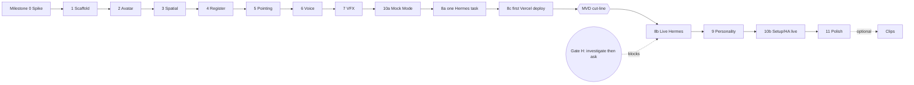

# Capri project plan

Capri is a spatial AI companion for Meta Quest 3 and 3S, built as a static WebXR site in TypeScript with IWSDK and Three.js. This plan fixes the build order, the cut-line, the working rules, and the project structure. It contains no per-step time estimates or time budgets.

## Context

- Competition: Meta VR Start Developer Competition 2026, Track Productivity, Division New Experience. Also targeting the "Best Agentic Interaction" special award.
- Deadline: **Nov 18, 2026, 12:00pm PST**. The spec was written on Nov 16, 2026. The deadline is context only. The plan relies on order and cut-line, not on duration estimates.
- Hosting: Vercel, served from the root of the user's custom subdomain (Vite `base: '/'`). The user supplies the subdomain and adds the DNS `CNAME` record that Vercel displays.
- Hard constraints: hands only, no controller code path, usable seated and stationary, a hosted WebXR link, and playable by judges without a smart home through Mock Mode.

## Tiers and cut-line

| Tier | Top-level tasks | Contents |
|------|-----------------|----------|
| Milestone 0 | 1, 2 | On-headset feasibility spike, items (a) to (e) |
| MVD (minimum viable demo) | 3 to 20 | Steps 1 to 7 (tasks 3, 5, 7, 9, 11, 13, 15), Mock Mode (17), one scripted Hermes task, `vercel.json` and the first Vercel deploy on the custom subdomain (19), MVD cut-line marker (20) |
| Post-MVD | 21 to 30 | Live Hermes and Tier 2 (21), personality (23), setup, live Home Assistant and CORS docs (25), polish and smoke checks (27), submission deliverables (29) |
| OPTIONAL | 31 | Retargeted animation clips. Cut first. No core task depends on it. |

### Step order

Strict order: Milestone 0, then Steps 1 to 7, then Mock Mode (Step 10a), then one Hermes task (Step 8a), then the first Vercel deploy (Step 8c). That is the MVD. Mock Mode is the single planned exception to numeric order: it is built right after Step 7.

| Tier | Step | Modules delivered | Requirements |
|---|---|---|---|
| M0 | Spike | `spike/*`, `docs/spike-report.md` | 1 to 6 |
| MVD | 1 Scaffold and passthrough | `main.ts`, `app/*`, `xr/session`, `xr/hands`, `ui/status-chips` (stub), hand-lost message | 8, 9, 29, 30 |
| MVD | 2 Avatar presence | `avatar/avatar-loader`, `avatar-rig`, `procedural-animator`, `pose-buffer`, `gestures/{idle,blink,breathe,wave,lookat}`, `config/avatar-config`, `domain/placement` | 10 |
| MVD | 3 Spatial interaction | `xr/scene-surfaces`, `domain/surfaces`, `avatar/locomotion`, `gestures/{point,sit,perch}`, `domain/actions/abilities` | 11 |
| MVD | 4 Device registration | `domain/devices/*`, `persistence/{device-store,local-store,anchor-store}`, `xr/hit-capture`, `ui/device-marker`, `ui/panels/device-list`, "Teach me your lights" flow | 12 |
| MVD | 5 Pointing | `domain/pointing/*`, `xr/hands`, `xr/head`, marker highlight, gaze link to animator | 13 |
| MVD | 6 Voice loop | `audio/*`, `domain/speech-lang/*`, `domain/speech/*`, `domain/persona/*`, `ui/panels/{mic-orb,transcript,quick-actions}`, `ui/hand-keyboard`, `tools/voice-script`, `voice/voice-manifest.txt` | 14, 15, 16, 17, 22 |
| MVD | 7 Hacking VFX | `vfx/*`, `domain/actions/hack-sequence`, `audio/sfx-synth`, `avatar/gestures/{flick,shrug,celebrate}` | 18 |
| MVD | 10a Mock Mode | `backends/types`, `backends/mock/*`, `domain/settings/mode-resolver`, `ui/status-chips` (full), `ui/setup-page` (mock default) | 23, 27 |
| MVD | 8a One Hermes task | `backends/hermes/hermes-adapter` interface, `MockAgentBackend` scripted task, `ui/panels/task-panel`, `domain/contract/task-model`. Live adapter only after Gate H. | 19, 23.5 |
| MVD | 8c First Vercel deploy | `vercel.json`, `build:vercel` script, Vercel project, custom subdomain attached, hosted Mock Mode link handed off | 8.9, 30.2 to 30.4, 30.9 to 30.14 |
| Post-MVD | 8b Live Hermes and Tier 2 | `backends/hermes/live-hermes-adapter`, `transports/*`, `domain/contract/*`, `domain/context/spatial-context`, `docs/hermes-integration.md` | 19, 20, 26.4 |
| Post-MVD | 9 Personality | `gestures/{stretch,fidget,glance,ignored,notify,tease}`, idle scheduler, banter memory | 21, 17.8 to 17.10 |
| Post-MVD | 10b Setup, live HA, CORS docs | `ui/setup-page` (full), `persistence/credential-store`, `backends/ha/*`, README sections | 24, 25, 26, 27 |
| Post-MVD | 11 Polish | `ui/{loading,pause,perf-overlay}`, audio mix, comfort check, `docs/{performance-note,comfort-check,demo-path}.md`, `npm run check` added to `build:vercel` | 28, 29, 30, 31 |
| OPTIONAL | Clips | `avatar/clips/*`, `gesture-router` clip branch | 32 |



### Cut-line status

- [ ] Milestone 0 complete
- [ ] MVD cut-line reached (Steps 1 to 7, Mock Mode, one Hermes task, first Vercel deploy). Mark this when task 20 is done, before any Post-MVD work starts.

### Cut order under schedule pressure

1. OPTIONAL items (retargeted clips) first.
2. Then the remaining Post-MVD scope, item by item: polish items, then personality (9), then live Home Assistant (10b), then live Hermes (8b).
3. Never an MVD item.

If live Home Assistant is cut, the submission still satisfies "playable without a smart home" through Mock Mode.

## Working rules

1. **Strict order.** Milestone 0, then Steps 1 to 11 in numeric order, with the one exception that Mock Mode follows Step 7.
2. **Finish and verify each step before the next.** Run `npm run typecheck`, `npm test -- --run`, the build, and the IWSDK emulator where possible. Then the step is done. Final verification happens on the target headset.
3. **Vertical slice over breadth.** A working demoable slice beats partial coverage of many features.
4. **Small commits.** One commit per coherent change.
5. **Hand-off note per step.** Short and non-blocking. It states what to test, what the user should see, and how to open the build on the Quest: the HTTPS dev URL (`https://<LAN-IP>:<port>/`, accept the certificate warning), the hosted custom-subdomain URL once it exists, a tunnel (Cloudflare Tunnel or ngrok, fallback only), or `adb reverse tcp:<port> tcp:<port>` with `https://localhost:<port>/`. After writing the note, continue to the next task without waiting for a reply.
6. **Three waiting rules.** Stop and wait for the user only for:
   - (a) a Milestone 0 failure, after stating it and the cheapest workaround, for the user's confirmation of the workaround;
   - (b) Gate H, the Hermes investigate-then-ask gate: no Hermes client code, endpoint, credential, header, field name, or example call exists before the user has supplied them;
   - (c) a specific missing input: voice engine (before Step 6), custom subdomain and Vercel domain verification, Home Assistant details, or Hermes details.
7. **Immediate failure reporting.** If anything fails on the headset (anchors, microphone, Vosk, speech output, or anything else), tell the user plainly at once and propose the cheapest workaround, then continue with unaffected work. Inside Milestone 0 the developer also waits for confirmation (rule 6a).
8. **Secrets only on the device.** Home Assistant and Hermes settings are entered through the Setup_Page and stored in the device's browser storage. They are never in the repository, the bundle, the build environment, or logs. Tokens are never logged.
9. **One input at a time.** When user input is needed, ask for one item at a time.
10. **Explain briefly.** Each non-obvious step gets a short explanation, and the user is told exactly what to do on the headset.
11. **No time reporting.** Never ask the user to log timestamps, report elapsed time, or give headset time.
12. **Spike length.** The Milestone 0 spike follows a soft guideline of staying short (about 2 hours of working time). It requires no timestamp logging and no time reports from the user. This is the only duration mentioned in the plan, and it is a guideline, not a budget.
13. **Long-lived commands.** Never run `npm run dev` in the foreground. Start it as a background process, or ask the user to run it.

## Proposed project structure

```text
capri/
├─ index.html                  Setup_Page (2D DOM) + #scene-container        [MVD]
├─ spike.html                  Milestone 0 harness entry (separate Vite input)   [M0]
├─ iwsdk.config.json           world/xr/features/dev.emulator settings           [MVD]
├─ vite.config.ts              iwsdkDev(), base = "/", two inputs                [MVD]
├─ vercel.json                 static Vite build, dist, SPA-safe rewrites, security headers   [MVD]
├─ .env.example                dev-only placeholders                              [MVD]
├─ voice/voice-manifest.txt    Voice_Manifest                                     [MVD]
├─ public/
│  ├─ models/capri.vrm         placeholder VRM (path named only in avatar-config)
│  ├─ voice/*.mp3              generated Voice_Library
│  ├─ vosk/                    model tarball (fetched by script, git-ignored)
│  └─ ui/*.uikitml, scenes/main.iwsdk.scene.json
├─ tools/                      dev-time only, never bundled
│  ├─ voice-script/            generate-voice-library.ts, engines/*
│  ├─ fetch-vosk-model.ts, build-lexicon.ts
│  └─ checks/                  smoke checks (secrets leak, assets https, manifest, docs)
├─ docs/                       project-plan.md, spike-report.md, hermes-integration.md,
│                              performance-note.md, comfort-check.md, demo-path.md,
│                              hosting.md, THIRD_PARTY.md
├─ src/
│  ├─ main.ts                  composition root
│  ├─ app/                     capri-system, app, events, clock, rng, frame-context, safe-run
│  ├─ config/                  avatar-config.ts (the single VRM path), constants.ts, feature-flags.ts
│  ├─ domain/                  PURE: no three, @iwsdk/*, vosk-browser, window, or document
│  │  ├─ geometry.ts, surfaces.ts, placement.ts, ui-placement.ts
│  │  ├─ devices/              registry.ts, naming.ts
│  │  ├─ pointing/             ray.ts, selector.ts, pinch.ts, capture.ts
│  │  ├─ speech-lang/          phrases.ts, grammar-builder.ts, intent-parser.ts, resolver.ts, lexicon.ts
│  │  ├─ persona/              persona.ts, banter.ts, templates.ts, truncate.ts, action-memory.ts, call-state.ts
│  │  ├─ actions/              hack-sequence.ts, timers.ts, places.ts, abilities.ts
│  │  ├─ context/              spatial-context.ts
│  │  ├─ contract/             response-contract.ts, tier-router.ts, task-model.ts
│  │  ├─ speech/               tier-select.ts, variant-picker.ts, lip-flap.ts, voice-manifest.ts
│  │  └─ settings/             mode-resolver.ts, url-guard.ts, redact.ts, credentials.ts, status.ts
│  ├─ backends/
│  │  ├─ types.ts              SmartHomeBackend, AgentBackend, BackendError
│  │  ├─ mock/                 mock-home.ts, mock-agent.ts
│  │  ├─ ha/                   ha-requests.ts (pure), ha-client.ts, ha-errors.ts
│  │  └─ hermes/               hermes-adapter.ts (interface); live adapter and transports only after Gate H
│  ├─ xr/                      session, hands, head, scene-surfaces, anchors, hit-capture, fake-hands (dev)
│  ├─ avatar/                  loader, rig, procedural-animator, pose-buffer, gestures/*, locomotion, mouth, clips/* [OPTIONAL]
│  ├─ audio/                   audio-engine, voice-player, sfx-synth, tts-fallback, mic-capture, stt-engine
│  ├─ vfx/                     hacking-vfx, particle-pool, beam, glyphs, pulse, quality-governor
│  ├─ ui/                      panels/*, setup-page/*, speech-bubble, hand-keyboard, status-chips, loading, pause, perf-overlay, device-marker
│  ├─ persistence/             device-store, local-store, anchor-store, credential-store, places-store
│  └─ spike/                   spike-main.ts, items/{a..e}.ts, report.ts, workarounds.ts
└─ tests/                      unit/, property/, component/, arbitraries/, fixtures/
```

Structure rules:

- `src/domain/` is pure TypeScript. Time comes from an injected `Clock`, randomness from an injected `Rng`. A lint rule and `tests/unit/arch.test.ts` enforce the boundary.
- XR, audio, and UI code are thin adapters that implement ports declared in `domain/`.
- Home Assistant and Hermes sit behind `SmartHomeBackend` and `AgentBackend`. Persona, orchestrator, and animator are identical in Mock and Live.
- Tests use Vitest and fast-check.

## IWSDK API confirmation

Checked on the plan date against the published `@iwsdk/core@1.1.0` and `@iwsdk/xr-input@1.1.0` packages (typings in `dist/**/*.d.ts` and the compiled sources), plus the Meta IWSDK documentation. `@iwsdk/core` 1.1.0 is `latest`, and `1.2.0-rc.0` is `next`. The exact version is pinned again in task 1.2 after scaffolding. Node requirement: `>=20.19 <21`, `>=22.12 <23`, or `>=24`. The local machine runs Node v26.8.1, which satisfies the `>=24` range.

Everything below is "confirmed in typings or source". Whether a runtime feature actually works on the Quest Browser is decided by the Milestone 0 spike, not by this list.

### Confirmed available

| Area | API (as found in 1.1.0) | Notes |
|---|---|---|
| World and session | `World.create(container, options)`. `options.xr = { sessionMode, referenceSpace, features, offer: 'none' \| 'once' \| 'always', restoreCameraOnExit, launchOnSessionGranted }`. `world.launchXR(partial?)`, `world.exitXR()`, `world.xrDefaults`. | `offer` is on `WorldOptions['xr']`, not on `XROptions`. `launchXR` merges `xrDefaults`. |
| Passthrough | `SessionMode.ImmersiveAR`. The renderer is created with `alpha: true` when the session mode is `ImmersiveAR`. | There is no separate passthrough API. Passthrough is the AR session mode. |
| Reference space | `ReferenceSpaceType.{BoundedFloor, Local, LocalFloor, Unbounded, Viewer}` with `fallbackOrder`. | Default `local-floor`, fallbacks `local`, `viewer`. |
| Feature flags | `features: { handTracking, anchors, hitTest, planeDetection, meshDetection, depthSensing, layers, unbounded, gazeTracking, eyeTracking }`. Each is `boolean \| { required }`. `depthSensing` also takes `{ usage: 'cpu-optimized' \| 'gpu-optimized', format: 'luminance-alpha' \| 'float32' }`. | Matches the design's world configuration. |
| World features | `features: { locomotion, grabbing, gaze, physics, sceneUnderstanding, environmentRaycast, camera, spatialUI }`. | `physics: false` keeps Havok out of the bundle (it is loaded by dynamic import only when enabled). |
| Hand tracking | `world.input.xr` is an `XRInputManager`. It has `xrOrigin`, `multiPointers`, `gamepads`, and `visualAdapters.hand.{left,right}`. `XRInputDeviceType.Hand`. Hand visuals: `AnimatedHand`, `XRHandVisualAdapter`, which uses `XRFrame.fillPoses`. | Hand skeleton rendering is available from IWSDK for Step 1. |
| Hand index tip and rays | `XROrigin` exposes `head`, `eyeSpace`, `raySpaces`, `gripSpaces`, `secondaryRaySpaces`, `secondaryGripSpaces`, and **`indexTipSpaces.{left,right}`**. `indexTipSpaces` is updated from the hand's index-tip joint each frame, and falls back to `raySpaces` for controllers. | New finding: this gives a documented index-fingertip pose, so the pointing ray origin does not need raw `getJointPose`. Other joints (thumb tip for pinch, index proximal for direction) still need raw `XRFrame.getJointPose` or `fillPoses` (assumption A3). |
| Pinch | `XRInputManager` tracks per-hand select state (`start`, `end`, `active`) from the hand input sources and feeds it to its gaze pointer as `pinchStart`, `pinchEnd`, `pinchActive`. It is internal, not a public pinch API. | Our own `domain/pointing/pinch.ts` computes pinch from joints, so it does not depend on this. |
| Planes | `XRPlane` component (field `_plane`, the raw `XRPlane`). Entities appear and disappear through `world.queries` `qualify` and `disqualify`. Auto-registered when `features.sceneUnderstanding` is on. | **`XRPlane` has no `semanticLabel` field.** Read `semanticLabel` from the raw `_plane` (assumption A4). |
| Meshes | `XRMesh` component: `_mesh`, `isBounded3D`, `semanticLabel`, `min`, `max`, `dimensions`. `SceneUnderstandingSystem` fills `semanticLabel` from the raw mesh and sets an empty label for `global mesh`. | Labels come from the browser. Whether the Quest Browser populates them is Spike item (b). |
| Anchors | `XRAnchor` component (`attached`). `SceneUnderstandingSystem` keeps **one** anchor, created at the reference-space origin, stores its persistent-handle UUID in `localStorage` (via `requestPersistentHandle`), and restores it on the next session through `session.restorePersistentAnchor`. Entities with `XRAnchor` are reparented under a world-stable group. | **This is one global anchor, not one anchor per object.** Per-light persistence (Step 4) needs our own raw `frame.createAnchor`, `anchor.requestPersistentHandle`, and `session.restorePersistentAnchor` calls (`persistence/anchor-store.ts`). The IWSDK anchor is still useful as a drift-stabilising parent group. |
| Hit-test | `features.hitTest`. `EnvironmentRaycastTarget` component with `space` (`RaycastSpace.Left/Right/Viewer/Screen`), `maxDistance`, offsets, and the result `xrHitTestResult`. `World.requestHitTestSourceForTransientInput(...)`. | Needs `features.environmentRaycast` (registers `EnvironmentRaycastSystem`) and `xr.features.hitTest`. |
| Depth | `xr.features.depthSensing` with usage and format. `DepthSensingSystem` (config: `enableOcclusion`, `enableDepthTexture`, `useFloat32`, `blurRadius`) and the `DepthOccludable` component (`SoftOcclusion`, `HardOcclusion`, `MinMaxSoftOcclusion`). | **`DepthSensingSystem` is not auto-registered.** Call `world.registerSystem(DepthSensingSystem)` yourself. Depth is a bonus item in the spike and is off in the product. |
| Gaze | `features.gazeTracking`, `GazeSystem`, `XROrigin.eyeSpace`. | Quest 3 and 3S have no eye tracking (assumption A15). Capri uses head-forward as gaze through a `GazeProvider` port. |
| Audio output | `AudioSource` component (`src`, `volume`, `loop`, `autoplay`, `positional`, `refDistance`, `rolloffFactor`, `maxDistance`, `distanceModel`, cone fields), `AudioSystem` (creates an `AudioListener` on the head, pools `Audio` and `PositionalAudio`), `PlaybackMode`. | Output only. Usable for positional chirps and voice lines. We still need our own `AudioContext` and `AnalyserNode` for lip-flap amplitude, so `audio/audio-engine.ts` stays our own. |
| Microphone | **No IWSDK microphone API.** | Use the browser's `navigator.mediaDevices.getUserMedia` directly (Spike item (c)). The `CameraSystem` in IWSDK calls `getUserMedia` for video only. |
| Spatial UI | `features.spatialUI`, UIKitML (`.uikitml`, `@drawcall/uikitml`), `@pmndrs/uikit`, `@pmndrs/pointer-events`, `@pmndrs/handle`. | UIKit units are centimetres at scale 1, so panel entities carry a scale of 0.01. |
| Emulator | IWER injected by `iwsdkDev()` from the Vite plugin (`@iwsdk/vite-plugin-dev`, current 1.1.0), with device presets and `dev.emulator.environment` rooms. | Hand pointing cannot be driven by IWER's hand model (assumption A14), so Step 5 adds a dev-only `FakeHands` provider. |
| Related packages | `@pixiv/three-vrm@3.5.5` (peer `three >=0.137`), `vosk-browser@0.0.8`. `@iwsdk/core` depends on `three: npm:super-three@0.185.0`. | Single copy of `three` is checked in task 1.2 (assumption A2). |

### Gaps and corrections relative to the design

These do not change the plan or order. They adjust how later tasks should be implemented.

1. **Semantic labels on planes** are read from the raw `XRPlane` held in `XRPlane._plane`. The IWSDK `XRPlane` component has no label field. Meshes expose `semanticLabel` directly. (Design assumption A4 already reads through `_plane` and `_mesh`.)
2. **Persistent anchors** in IWSDK are a single origin anchor. Step 4 must create per-light anchors with the raw WebXR anchor API. The `AnchorDeviceStore` in the design already does this. Do not use `XRAnchor` components for per-light persistence.
3. **Depth occlusion** requires registering `DepthSensingSystem` manually. Only the spike (item (b), bonus probe) turns it on.
4. **Index fingertip pose** is available as `world.input.xr.xrOrigin.indexTipSpaces`. Design assumption A3 ("IWSDK has no documented joint API") is still true for the other joints. Task 1.5 should check whether `indexTipSpaces` is usable on the Quest before relying on it, and it can serve as the cheapest fallback for the pointing ray origin.
5. **`offer`** belongs to the `xr` world option (`WorldOptions.xr.offer`), not to `XROptions`, so it cannot be passed to `launchXR`. This matches the design's `World.create` usage.
6. **No IWSDK microphone API.** Microphone capture and Vosk stay entirely in our own `audio/*` adapters.

### Not decided by typings (decided on the headset in Milestone 0)

| Item | What the spike decides |
|---|---|
| (a) | Whether the Quest Browser gives hand joint poses with no controller connected, and whether IWSDK's hand visuals show. |
| (b) | Whether planes, semantic labels, meshes, anchors (including persistence across reload), hit-test, and depth occlusion actually work. |
| (c) | Whether `getUserMedia` works during an immersive session. |
| (d) | Whether Vosk loads and recognises the restricted grammar, and how fast and how accurately. |
| (e) | Whether `speechSynthesis` exists and has a usable voice. |

## Sources

- IWSDK npm packages `@iwsdk/core@1.1.0` and `@iwsdk/xr-input@1.1.0` (typings and compiled sources, inspected on the plan date).
- [Meta Horizon OS Developers: IWSDK overview](https://developers.meta.com/horizon/documentation/iwsdk/guides/overview/)
- [Meta Horizon OS Developers: IWSDK depth occlusion guide](https://developers.meta.com/horizon/documentation/iwsdk/guides/15-depth-occlusion/)
- [facebook/immersive-web-sdk on GitHub](https://github.com/facebook/immersive-web-sdk)
